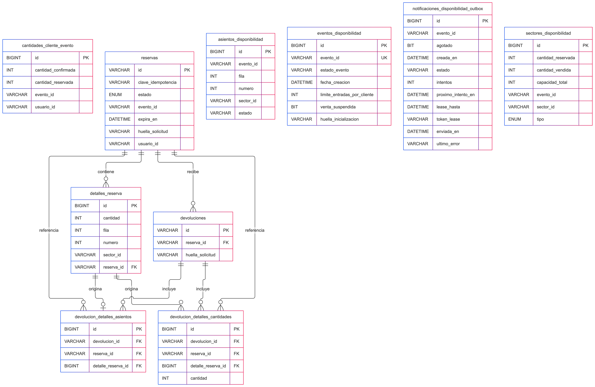

# Gestión de disponibilidad y reservas

Microservicio **Spring Boot de TicketYa**. Gestiona la disponibilidad de los eventos, los sectores, los asientos numerados y las reservas temporales. También administra la confirmación y liberación de reservas, las devoluciones de entradas y la actualización de la disponibilidad.

Persiste la información en MySQL mediante JPA/Hibernate y utiliza Flyway para administrar las migraciones de la base de datos. Se comunica directamente con los demás microservicios mediante REST/JSON.

## Requisitos

- JDK 21 o superior.
- Maven 3.9 o superior.
- MySQL 8.0 o superior.
- Docker Desktop con Docker Compose, si se utiliza para levantar MySQL localmente.

## Levantar la base de datos y el servicio

Ejecutá los siguientes pasos desde la carpeta raíz del proyecto MS2.

### 1. Iniciar MySQL

La configuración local predeterminada utiliza:

- Host: `localhost`.
- Puerto: `3307`.
- Base de datos: `disponibilidad_reservas`.

La URL JDBC configurada es:

```properties
jdbc:mysql://localhost:3307/disponibilidad_reservas
```

La base debe estar disponible antes de iniciar el servicio. Configurá las credenciales mediante variables de entorno; no hay contraseña predeterminada.

### 2. Iniciar el microservicio

```bash
./mvnw spring-boot:run
```

Por defecto, MS2 escucha en:

```text
http://localhost:8080
```

El nombre de la aplicación es `ms-disponibilidad-reservas`.

### 3. Detener el servicio

Si se inició desde Maven, se puede detener con `Ctrl + C`.

La detención del servicio no elimina los datos almacenados en MySQL.

## Endpoints

El servicio utiliza `http://localhost:8080` como URL base.

MS2 tiene una operación pública, accesible a través del API Gateway, y operaciones internas destinadas a la comunicación entre microservicios.

Las llamadas internas utilizan REST/JSON, sin pasar por el Gateway y sin autenticación entre microservicios, según el acuerdo del equipo.

### Operación pública

| Método | Ruta                                          | Identidad | Descripción                                                       |
| ------ | --------------------------------------------- | --------- | ----------------------------------------------------------------- |
| POST   | `/disponibilidad/eventos/{eventoId}/reservas` | Cliente   | Crea una reserva temporal para uno o varios lugares de un evento. |

La operación pública requiere `X-User-Id` y `X-User-Roles` con el rol `CLIENTE`; los roles pueden estar separados por comas. El Gateway valida el JWT y propaga los encabezados confiables. MS2 no valida JWT.

La reserva es atómica: se reservan todos los lugares solicitados o ninguno.

### Operaciones internas: MS1 → MS2

| Método | Ruta                                       | Descripción                                                                             |
| ------ | ------------------------------------------ | --------------------------------------------------------------------------------------- |
| PUT    | `/disponibilidad/eventos/{eventoId}`       | Inicializa la disponibilidad de un evento, sus sectores y sus asientos.                 |
| PUT    | `/disponibilidad/eventos/{eventoId}/venta` | Actualiza el estado de venta de un evento.                                              |
| GET    | `/disponibilidad/eventos/{eventoId}`       | Consulta la disponibilidad actual por sector y los asientos libres, cuando corresponda. |

Estas operaciones son utilizadas por MS1 (Gestión de eventos). No deben exponerse como operaciones públicas del Gateway.

### Operaciones internas: MS3 → MS2

| Método | Ruta                                                | Descripción                                                               |
| ------ | --------------------------------------------------- | ------------------------------------------------------------------------- |
| GET    | `/disponibilidad/reservas/{reservaId}`              | Consulta una reserva y devuelve su estado, vencimiento y detalles.        |
| POST   | `/disponibilidad/reservas/{reservaId}/confirmacion` | Confirma una reserva después de que MS3 recibe la aprobación del pago.    |
| POST   | `/disponibilidad/reservas/{reservaId}/liberacion`   | Libera una reserva por rechazo de pago o procesa una devolución aprobada. |

Estas operaciones son utilizadas por MS3 (Compras y devoluciones). No deben exponerse como operaciones públicas del Gateway.

### Comunicación saliente: MS2 → MS1

Cuando cambia la disponibilidad de un evento, MS2 notifica a MS1 mediante:

```http
PUT /eventos/{eventoId}/disponibilidad
```

Body:

```json
{
  "agotado": true
}
```

Se envía `true` cuando el evento queda agotado y `false` cuando vuelve a tener disponibilidad.

MS2 utiliza un mecanismo Outbox para registrar y reintentar las notificaciones pendientes. Solo notifica cuando cambia la situación de disponibilidad, no en cada consulta o reserva.

## Funcionamiento de las reservas

### Inicialización de disponibilidad

Cuando MS1 publica un evento, envía a MS2 su identificador, el límite de entradas por cliente y los sectores.

Cada sector contiene:

- `sectorId`.
- `tipo`.
- `capacidadTotal`.
- `asientos`, cuando es numerado.

Los sectores numerados reciben los asientos individualmente, identificados por `fila` y `numero`. Los sectores no numerados utilizan una lista de asientos vacía.

MS2 registra la disponibilidad inicial y permite que las operaciones posteriores trabajen sobre los sectores y lugares recibidos.

### Creación de reservas temporales

El cliente solicita una reserva mediante:

```http
POST /disponibilidad/eventos/{eventoId}/reservas
```

El cuerpo contiene una lista de detalles:

- Sectores numerados: `sectorId`, `fila` y `numero`.
- Sectores no numerados: `sectorId` y `cantidad`.

Cada reserva tiene una duración de **10 minutos**.

MS2 genera el identificador `reservaId` y devuelve la fecha y hora de expiración.

La identificación de una solicitud se realiza mediante la combinación `clienteId + solicitudId`:

- Una solicitud nueva se responde con `201 Created`.
- Si se repite con el mismo identificador y contenido, mientras la reserva original siga vigente, se devuelve la reserva existente con `200 OK`.
- Si se reutiliza el identificador con contenido diferente, se responde `409 Conflict`.
- Si la reserva original venció o fue liberada, se responde `409 Conflict`; no se crea automáticamente otra reserva.

### Confirmación

Cuando MS3 recibe la aprobación del pago, solicita confirmar la reserva.

MS2 verifica que siga vigente y que no haya vencido. Si la operación es válida, la reserva pasa a `CONFIRMADA` y los lugares pasan de reservados a vendidos.

Una confirmación repetida de una reserva ya confirmada responde `204 No Content`, sin volver a contabilizar la venta.

### Liberación y devoluciones

MS2 permite liberar reservas por dos motivos:

- `PAGO_RECHAZADO`: libera una reserva temporal que todavía no fue confirmada.
- `DEVOLUCION_APROBADA`: libera lugares que ya fueron vendidos. Puede afectar una parte de la reserva.

Las devoluciones utilizan `devolucionId` para identificar la operación y evitar procesar dos veces los mismos efectos.

Si se repite una devolución con el mismo identificador y los mismos detalles, se conserva el comportamiento idempotente acordado. Si se reutiliza el identificador con detalles diferentes, se responde `409 Conflict`.

No se deben liberar dos veces los mismos lugares ni modificar repetidamente los contadores.

### Vencimiento automático

MS2 cuenta con un proceso automático que busca reservas temporales vencidas y libera sus lugares.

La expiración lógica se determina por `expiraEn`. La recuperación física de la disponibilidad se realiza cuando el proceso automático ejecuta la liberación.

El estado persistido `VIGENTE` por sí solo no garantiza vigencia temporal: al consultar una reserva también debe considerarse `expiraEn`. Para el límite por cliente, una reserva lógicamente vencida deja de contar aunque sus lugares y su contador permanezcan retenidos hasta la liberación efectiva.

El intervalo de ejecución predeterminado del scheduler es de 60 segundos.

## Estados y disponibilidad

### Estados de reserva

| Estado       | Descripción                                                                                                                                 |
| ------------ | ------------------------------------------------------------------------------------------------------------------------------------------- | --- |
| `VIGENTE`    | Reserva temporal que todavía no fue confirmada ni liberada.                                                                                 |
| `CONFIRMADA` | Reserva confirmada después de la aprobación del pago. Conserva este estado aunque posteriormente se apruebe una devolución parcial o total. |     |
| `LIBERADA`   | Reserva temporal cuyos lugares fueron liberados por vencimiento o rechazo de pago.                                                          |

### Estados de venta recibidos desde MS1

MS2 recibe los siguientes valores:

- `ACTIVA`.
- `SUSPENDIDA`.
- `CANCELADA`.
- `FINALIZADA`.

La actualización del estado de venta condiciona las operaciones de reserva y liberación de acuerdo con las reglas de negocio definidas por el equipo.

### Disponibilidad por sector

MS2 administra dos tipos de sectores:

- `NUMERADO`: cada asiento se identifica mediante `sectorId`, `fila` y `numero`, y puede estar libre, reservado o vendido.
- `NO_NUMERADO`: la disponibilidad se administra mediante cantidades de lugares reservados y vendidos.

La identidad de un asiento numerado es la combinación:

```text
(sectorId, fila, numero)
```

La capacidad total y las cantidades disponibles se administran por sector.

## Identidad, integraciones y puertos

La comunicación entre microservicios es directa mediante REST/JSON y no utiliza autenticación entre servicios, de acuerdo con las decisiones de arquitectura del equipo.

| Microservicio | Responsabilidad           | Puerto local |
| ------------- | ------------------------- | -----------: |
| MS1           | Gestión de eventos        |       `8081` |
| MS2           | Disponibilidad y reservas |       `8080` |
| MS3           | Compras y devoluciones    |       `8083` |

Las operaciones públicas llegan a MS2 mediante el Gateway. Las operaciones internas entre microservicios no deben exponerse a través de él.

El Gateway propaga `X-User-Id` y `X-User-Roles`. El endpoint de reserva exige `CLIENTE`. Restringí el acceso directo a MS2 a redes confiables: los encabezados no son una prueba de identidad por sí mismos.

## Respuestas y manejo de errores

Las respuestas de error utilizan el formato acordado:

```json
{
  "timestamp": "...",
  "status": 409,
  "error": "...",
  "mensaje": "...",
  "campos": [
    {
      "campo": "detalles",
      "mensaje": "Uno o más lugares no están disponibles."
    }
  ]
}
```

El campo `campos` es opcional y se incluye cuando es necesario informar errores específicos de validación.

Los códigos HTTP utilizados dependen de la operación. Entre los principales se encuentran:

| Código | Significado                                                  |
| ------ | ------------------------------------------------------------ |
| `200`  | Consulta correcta o reintento idempotente de creación.       |
| `201`  | Reserva creada correctamente.                                |
| `204`  | Operación correcta sin contenido de respuesta.               |
| `401`  | Identidad ausente o inválida.                                      |
| `403`  | El usuario carece del rol requerido.                               |
| `502`  | Respuesta externa inválida.                                       |
| `503`  | Servicio externo no disponible o resultado incierto.             |
| `400`  | Datos o parámetros inválidos.                                |
| `404`  | Recurso no encontrado.                                       |
| `409`  | Conflicto con el estado actual o con una solicitud anterior. |
| `500`  | Error interno del servicio.                                  |

## Documentación de API

El contrato OpenAPI de MS2 se encuentra en:

```text
docs/openapi/ms2.yaml
```

Este archivo documenta las rutas, parámetros, encabezados, cuerpos y respuestas de las operaciones públicas e internas.

## Base de datos y migraciones

MS2 utiliza MySQL con JPA/Hibernate para la persistencia y Flyway para gestionar el esquema.

Las migraciones se encuentran en:

```text
src/main/resources/db/migration/
```

La aplicación utiliza:

```properties
spring.jpa.hibernate.ddl-auto=validate
```

Hibernate valida que las entidades sean compatibles con el esquema existente, sin generar automáticamente modificaciones de tablas.

La migración V7 establece comparaciones exactas de identificadores externos en las columnas correspondientes, preservando las restricciones e índices existentes.

## Pruebas automatizadas

Para compilar y ejecutar la suite de pruebas:

```bash
mvn clean test
```

Las pruebas que necesitan MySQL deben ejecutarse en un entorno de pruebas descartable y aislado. No deben utilizarse bases persistentes de desarrollo para pruebas que puedan modificar datos o aplicar migraciones.

## Modelo de datos

El siguiente diagrama representa las entidades y sus relaciones dentro de MS2.



## Entrega 2: fila virtual y observabilidad

Al crear una reserva, MS2 valida la solicitud y busca primero una reserva idéntica vigente por `(usuarioId, solicitudId)`. Si existe devuelve 200 sin consultar servicios externos; la misma clave con otro evento o contenido, o una reserva ya no vigente, devuelve 409. Para una solicitud nueva consulta `GET /internal/eventos/{eventoId}` de MS1. Si `requiereFila` es verdadero, consume el turno en MS7 mediante `POST /internal/filas/eventos/{eventoId}/consumos`, enviando los identificadores y la huella existentes.

Las llamadas HTTP ocurren antes de la transacción de creación. Tras bloquear el evento se comprueba otra vez la reserva idempotente y, para una reserva nueva con fila, el vencimiento de la autorización. También se comprueban estado de venta, inventario y límite por cliente; las reservas duran diez minutos. Un error remoto dispara una nueva búsqueda local de la reserva concurrente. Un timeout no restaura el turno: puede quedar consumido sin reserva y el cliente debe reintentar con la misma clave y contenido. No hay transacción distribuida ni outbox para la fila. La entrega de cambios de agotamiento a MS1 usa el outbox de disponibilidad existente, separado de este flujo.

Las llamadas sincrónicas a MS1 y MS7 utilizan circuitos independientes de Resilience4j 2.4.0. Cada circuito usa ventana de 10 llamadas, mínimo de 5, umbral de fallos del 50 % y espera de 30 segundos antes de probar recuperación; estos valores están definidos en código. Solo la consulta GET a MS1 reintenta una vez errores transitorios, con espera de 100 ms. El POST de consumo no tiene reintentos automáticos y el outbox conserva su propia política. Los timeouts HTTP configurables siguen siendo 2 segundos de conexión y 5 de lectura por defecto. Un circuito abierto se informa como indisponibilidad y no autoriza la reserva.

La validación del contenido de las respuestas de MS1 y MS7 ocurre dentro del circuito correspondiente. Una respuesta inválida cuenta como fallo y no se reintenta automáticamente; los errores de negocio definitivos se excluyen de las estadísticas del circuito.

Como limitación aceptada, una fila puede desactivarse o cancelarse después de que MS7 autorizó el consumo y antes de que MS2 complete la reserva local. La comprobación local del vencimiento no consulta nuevamente a MS7 y no elimina esa ventana de coordinación.

Si falta capacidad en un sector no numerado, el mensaje de conflicto informa los lugares disponibles observados bajo bloqueo durante la transacción. Si se supera el límite por cliente, informa el límite numérico del evento. Ambos pueden cambiar con operaciones posteriores.

El resumen por sector incorpora `cantidadReservada` y `cantidadVendida`: los nombres son una **propuesta pendiente de confirmación con MS1 y MS3**. En sectores numerados se cuentan estados de asientos; en los demás se usan los contadores persistidos.

`X-Correlation-Id` es opcional. Se acepta hasta 128 caracteres alfanuméricos, punto, guion, guion bajo y dos puntos; si falta o no es válido se genera un UUID. Se devuelve en la respuesta, se agrega al MDC y se propaga a MS1 y MS7. Las entregas asíncronas del outbox se registran separadamente y no heredan la correlación de una solicitud finalizada.

Hibernate no imprime SQL por defecto; para diagnóstico se puede establecer `SPRING_JPA_SHOW_SQL=true`. La centralización de logs corresponde a la integración grupal.

## Variables de entorno

| Variable | Valor predeterminado | Uso |
| --- | --- | --- |
| `SERVER_PORT` | `8080` | Puerto interno HTTP. |
| `MS2_DB_URL` | `jdbc:mysql://localhost:3307/disponibilidad_reservas` | Base propia de MS2. |
| `MS2_DB_USERNAME` | `root` | Usuario de base; configurar uno propio para el entorno. |
| `MS2_DB_PASSWORD` | vacío | Contraseña suministrada por el entorno. |
| `MS1_API_BASE_URL` / `MS7_API_BASE_URL` | `http://localhost:8081` / `http://localhost:8088` | Direcciones internas. |
| `MS2_MS1_CONNECT_TIMEOUT_MS` / `MS2_MS1_READ_TIMEOUT_MS` | `2000` / `5000` | Timeouts de consulta a MS1. |
| `MS2_MS7_CONNECT_TIMEOUT_MS` / `MS2_MS7_READ_TIMEOUT_MS` | `2000` / `5000` | Timeouts de consumo en MS7. |
| `MS2_RESERVAS_EXPIRACION_FIXED_DELAY_MS` | `60000` | Intervalo del scheduler de reservas. |
| `MS2_OUTBOX_FIXED_DELAY_MS` | `5000` | Intervalo del outbox de disponibilidad. |
| `MS2_OUTBOX_INITIAL_BACKOFF_MS` / `MS2_OUTBOX_MAX_BACKOFF_MS` | `1000` / `300000` | Reintentos del outbox. |
| `MS2_OUTBOX_LEASE_MS` / `MS2_OUTBOX_MAX_BATCH` | `15000` / `50` | Lease y tamaño de lote del outbox. |
| `MS2_OUTBOX_CONNECT_TIMEOUT_MS` / `MS2_OUTBOX_READ_TIMEOUT_MS` | `2000` / `5000` | Timeouts de notificación asíncrona a MS1. |

No incluyas contraseñas en imágenes ni archivos versionados. Flyway aplica V1–V7 y Hibernate valida el esquema; la base debe estar disponible y ser independiente de MS7.

## Imagen Docker

Desde este directorio ejecutá `docker build -t ticketya-ms2 .`. La imagen usa Java 21 y un usuario sin privilegios. Para ejecutarla suministrá `MS2_DB_URL`, `MS2_DB_USERNAME`, `MS2_DB_PASSWORD`, `MS1_API_BASE_URL` y `MS7_API_BASE_URL` mediante el entorno o un gestor de secretos y conectala a una red interna; `localhost` dentro del contenedor no es el host. El puerto interno predeterminado es 8080. El Dockerfile no publica puertos ni inicia una base.

Por ejemplo, con la red interna y los servicios `mysql-ms2`, `ms1` y `ms7` ya disponibles, exportá `MS2_DB_USERNAME` y `MS2_DB_PASSWORD` desde el entorno seguro y ejecutá:

```bash
docker run --rm --name ticketya-ms2 --network ticketya-interna \
  -e 'MS2_DB_URL=jdbc:mysql://mysql-ms2:3306/disponibilidad_reservas' \
  -e MS2_DB_USERNAME -e MS2_DB_PASSWORD \
  -e 'MS1_API_BASE_URL=http://ms1:8081' \
  -e 'MS7_API_BASE_URL=http://ms7:8088' ticketya-ms2
```

Los nombres y la red son ejemplos que deben coincidir con el despliegue real.

## Suite con MySQL descartable

Además de `./mvnw test`, las pruebas MySQL requieren una instancia nueva y descartable en un puerto local distinto de 3307, con esquemas `ms2_disposable` y `ms2_r2_disposable`. Configurá `MS2_TEST_MYSQL_URL`, `MS2_TEST_MYSQL_PASSWORD`, `MS2_R2_MYSQL_URL` y `MS2_R2_MYSQL_PASSWORD` con esa instancia y ejecutá `./mvnw -Dms2.mysql.integration=true test`. Las pruebas crean y eliminan esquemas; nunca apuntes a bases de desarrollo.

Para el entorno aislado de integración MS2–MS7 ejecutá `sh tests/integracion/ejecutar-compose.sh`. Levanta dos instancias de cada servicio, bases MySQL independientes, MS1 simulado, un proxy de fallos delante de MS7 real y el ejecutor de pruebas, con un nombre de proyecto único. El script elimina los contenedores, la red y los volúmenes de ese proyecto al terminar o fallar. No reemplaza las pruebas con MS1, MS3, MS6 y Gateway reales del equipo. La última ejecución individual con MySQL aislado registró 300 pruebas de MS2 y 59 de MS7, sin omisiones.

La ejecución Compose verifica consumo con fallo de reserva y reingreso, competencia por asiento, FIFO, idempotencia, límite por cliente, recuperación ante indisponibilidad simulada de MS1, ingresos simultáneos en dos MS7, vencimiento real de un turno y pérdida de la respuesta de un consumo real. El proxy simula la indisponibilidad de MS7 sin detener su instancia. El simulador no verifica los contratos ni la disponibilidad del MS1 del equipo.

La [matriz de cumplimiento individual](documentacion/Matriz-Cumplimiento-Entrega-2.md) reúne las verificaciones y distingue las limitaciones aceptadas y los pendientes de integración grupal.


## Integración Docker Compose (Entrega 2)

Crear una sola vez la red compartida: `docker network create ticketya-net`.
Copiar `.env.example` a `.env` y establecer contraseñas propias no vacías en
`MS2_DB_PASSWORD` y `MS2_MYSQL_ROOT_PASSWORD`. El archivo `.env` está
ignorado. Las variables y valores de ejemplo están documentados allí; los
cambios de credenciales no actualizan automáticamente un volumen MySQL ya inicializado.

Desde esta carpeta ejecutar `docker compose up -d --build`. El servicio `reservas`
escucha internamente en `8080`, y `mysql-reservas` usa MySQL 8.4 con base
`disponibilidad_reservas` y volumen `ticketya-ms2-mysql-data`. El Compose principal no publica
puertos. Depende de MS1 en `http://lugares:8081` y MS7 en `http://fila-virtual:8088`; estas URL son configurables.
Para desarrollo usar `docker compose -f docker-compose.yml -f docker-compose.dev.yml up -d --build`.
Los puertos de host se enlazan a 127.0.0.1 y son configurables mediante
`MS2_DEV_APP_PORT` y `MS2_DEV_DB_PORT`. Comprobar salud con
`curl -f http://127.0.0.1:${MS2_DEV_APP_PORT:-8080}/actuator/health` cuando
esté activo el override; también puede consultarse el estado con `docker compose ps`.
Actuator expone únicamente health sin detalles. La comprobación HTTP usa curl,
instalado en la imagen. No eliminar el volumen para detener los servicios.

La autenticación interna `X-Service-Token` / `SERVICIO_TOKEN` aún requiere acuerdo
sobre alcance, validación, errores y despliegue coordinado; no está habilitada.

Cada intento diferido del outbox genera un nuevo ID de correlación: no conserva el ID original de la solicitud que creó la notificación. El ID del intento se incluye en sus logs y en el header enviado a MS1.
