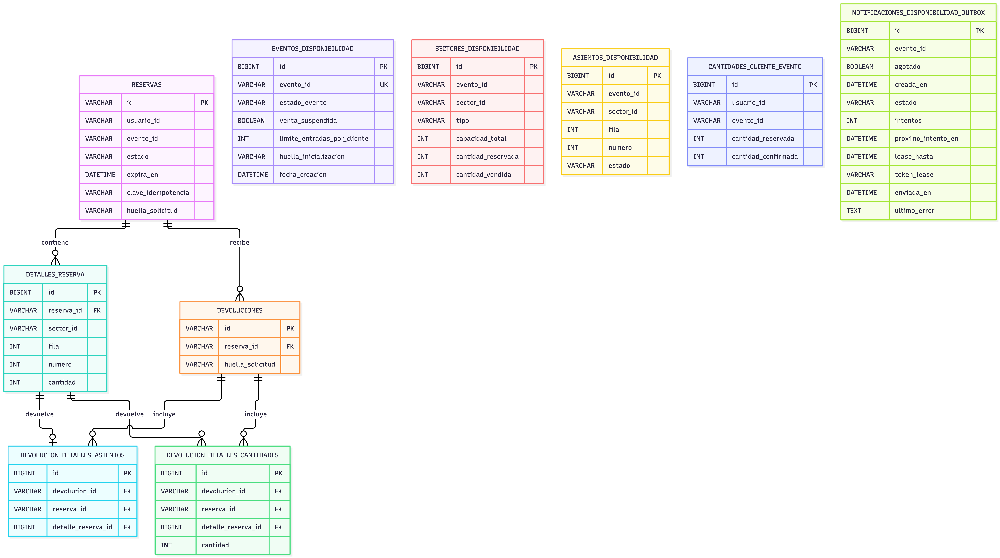

# Gestión de disponibilidad y reservas

Microservicio **Spring Boot de TicketYa**. Gestiona la disponibilidad de los eventos, los sectores, los asientos numerados y las reservas temporales. También administra la confirmación y liberación de reservas, las devoluciones de entradas y la actualización de la disponibilidad.

Persiste la información en MySQL mediante JPA/Hibernate y utiliza Flyway para administrar las migraciones de la base de datos. Se comunica directamente con los demás microservicios mediante REST/JSON.

## Requisitos

- JDK 21 o superior.
- Maven 3.9 o superior.
- MySQL 8.0 o superior.
- Docker Desktop con Docker Compose, si se utiliza para levantar MySQL localmente.

## Levantar la base de datos y el servicio

Ejecutá los siguientes pasos desde la carpeta raíz del proyecto MS2.

### 1. Iniciar MySQL

La configuración local conocida utiliza:

- Host: `localhost`.
- Puerto: `3307`.
- Base de datos: `disponibilidad_reservas`.

La URL JDBC configurada es:

```properties
jdbc:mysql://localhost:3307/disponibilidad_reservas
```

La base debe estar disponible antes de iniciar el servicio. Las credenciales y la configuración completa se encuentran en `application.yml` o en la configuración correspondiente del entorno.

### 2. Iniciar el microservicio

```bash
mvn spring-boot:run
```

Por defecto, MS2 escucha en:

```text
http://localhost:8080
```

El nombre de la aplicación es `ms-disponibilidad-reservas`.

### 3. Detener el servicio

Si se inició desde Maven, se puede detener con `Ctrl + C`.

La detención del servicio no elimina los datos almacenados en MySQL.

## Endpoints

El servicio utiliza `http://localhost:8080` como URL base.

MS2 tiene una operación pública, accesible a través del API Gateway, y operaciones internas destinadas a la comunicación entre microservicios.

Las llamadas internas utilizan REST/JSON, sin pasar por el Gateway y sin autenticación entre microservicios, según el acuerdo del equipo.

### Operación pública

| Método | Ruta                                          | Identidad | Descripción                                                       |
| ------ | --------------------------------------------- | --------- | ----------------------------------------------------------------- |
| POST   | `/disponibilidad/eventos/{eventoId}/reservas` | Cliente   | Crea una reserva temporal para uno o varios lugares de un evento. |

La operación pública requiere el encabezado `X-User-Id`, que identifica al cliente. El Gateway debe propagar este identificador.

La reserva es atómica: se reservan todos los lugares solicitados o ninguno.

### Operaciones internas: MS1 → MS2

| Método | Ruta                                       | Descripción                                                                             |
| ------ | ------------------------------------------ | --------------------------------------------------------------------------------------- |
| PUT    | `/disponibilidad/eventos/{eventoId}`       | Inicializa la disponibilidad de un evento, sus sectores y sus asientos.                 |
| PUT    | `/disponibilidad/eventos/{eventoId}/venta` | Actualiza el estado de venta de un evento.                                              |
| GET    | `/disponibilidad/eventos/{eventoId}`       | Consulta la disponibilidad actual por sector y los asientos libres, cuando corresponda. |

Estas operaciones son utilizadas por MS1 (Gestión de eventos). No deben exponerse como operaciones públicas del Gateway.

### Operaciones internas: MS3 → MS2

| Método | Ruta                                                | Descripción                                                               |
| ------ | --------------------------------------------------- | ------------------------------------------------------------------------- |
| GET    | `/disponibilidad/reservas/{reservaId}`              | Consulta una reserva y devuelve su estado, vencimiento y detalles.        |
| POST   | `/disponibilidad/reservas/{reservaId}/confirmacion` | Confirma una reserva después de que MS3 recibe la aprobación del pago.    |
| POST   | `/disponibilidad/reservas/{reservaId}/liberacion`   | Libera una reserva por rechazo de pago o procesa una devolución aprobada. |

Estas operaciones son utilizadas por MS3 (Compras y devoluciones). No deben exponerse como operaciones públicas del Gateway.

### Comunicación saliente: MS2 → MS1

Cuando cambia la disponibilidad de un evento, MS2 notifica a MS1 mediante:

```http
PUT /eventos/{eventoId}/disponibilidad
```

Body:

```json
{
  "agotado": true
}
```

Se envía `true` cuando el evento queda agotado y `false` cuando vuelve a tener disponibilidad.

MS2 utiliza un mecanismo Outbox para registrar y reintentar las notificaciones pendientes. Solo notifica cuando cambia la situación de disponibilidad, no en cada consulta o reserva.

## Funcionamiento de las reservas

### Inicialización de disponibilidad

Cuando MS1 publica un evento, envía a MS2 su identificador, el límite de entradas por cliente y los sectores.

Cada sector contiene:

- `sectorId`.
- `tipo`.
- `capacidadTotal`.
- `asientos`, cuando es numerado.

Los sectores numerados reciben los asientos individualmente, identificados por `fila` y `numero`. Los sectores no numerados utilizan una lista de asientos vacía.

MS2 registra la disponibilidad inicial y permite que las operaciones posteriores trabajen sobre los sectores y lugares recibidos.

### Creación de reservas temporales

El cliente solicita una reserva mediante:

```http
POST /disponibilidad/eventos/{eventoId}/reservas
```

El cuerpo contiene una lista de detalles:

- Sectores numerados: `sectorId`, `fila` y `numero`.
- Sectores no numerados: `sectorId` y `cantidad`.

Cada reserva tiene una duración de **10 minutos**.

MS2 genera el identificador `reservaId` y devuelve la fecha y hora de expiración.

La identificación de una solicitud se realiza mediante la combinación `clienteId + solicitudId`:

- Una solicitud nueva se responde con `201 Created`.
- Si se repite con el mismo identificador y contenido, mientras la reserva original siga vigente, se devuelve la reserva existente con `200 OK`.
- Si se reutiliza el identificador con contenido diferente, se responde `409 Conflict`.
- Si la reserva original venció o fue liberada, se responde `409 Conflict`; no se crea automáticamente otra reserva.

### Confirmación

Cuando MS3 recibe la aprobación del pago, solicita confirmar la reserva.

MS2 verifica que siga vigente y que no haya vencido. Si la operación es válida, la reserva pasa a `CONFIRMADA` y los lugares pasan de reservados a vendidos.

Una confirmación repetida de una reserva ya confirmada responde `204 No Content`, sin volver a contabilizar la venta.

### Liberación y devoluciones

MS2 permite liberar reservas por dos motivos:

- `PAGO_RECHAZADO`: libera una reserva temporal que todavía no fue confirmada.
- `DEVOLUCION_APROBADA`: libera lugares que ya fueron vendidos. Puede afectar una parte de la reserva.

Las devoluciones utilizan `devolucionId` para identificar la operación y evitar procesar dos veces los mismos efectos.

Si se repite una devolución con el mismo identificador y los mismos detalles, se conserva el comportamiento idempotente acordado. Si se reutiliza el identificador con detalles diferentes, se responde `409 Conflict`.

No se deben liberar dos veces los mismos lugares ni modificar repetidamente los contadores.

### Vencimiento automático

MS2 cuenta con un proceso automático que busca reservas temporales vencidas y libera sus lugares.

La expiración lógica se determina por `expiraEn`. La recuperación física de la disponibilidad se realiza cuando el proceso automático ejecuta la liberación.

El intervalo de ejecución predeterminado del scheduler es de 60 segundos.

## Estados y disponibilidad

### Estados de reserva

| Estado       | Descripción                                                                                                                                 |
| ------------ | ------------------------------------------------------------------------------------------------------------------------------------------- | --- |
| `VIGENTE`    | Reserva temporal que todavía no fue confirmada ni liberada.                                                                                 |
| `CONFIRMADA` | Reserva confirmada después de la aprobación del pago. Conserva este estado aunque posteriormente se apruebe una devolución parcial o total. |     |
| `LIBERADA`   | Reserva temporal cuyos lugares fueron liberados por vencimiento o rechazo de pago.                                                          |

### Estados de venta recibidos desde MS1

MS2 recibe los siguientes valores:

- `ACTIVA`.
- `SUSPENDIDA`.
- `CANCELADA`.
- `FINALIZADA`.

La actualización del estado de venta condiciona las operaciones de reserva y liberación de acuerdo con las reglas de negocio definidas por el equipo.

### Disponibilidad por sector

MS2 administra dos tipos de sectores:

- `NUMERADO`: cada asiento se identifica mediante `sectorId`, `fila` y `numero`, y puede estar libre, reservado o vendido.
- `NO_NUMERADO`: la disponibilidad se administra mediante cantidades de lugares reservados y vendidos.

La identidad de un asiento numerado es la combinación:

```text
(sectorId, fila, numero)
```

La capacidad total y las cantidades disponibles se administran por sector.

## Identidad, integraciones y puertos

La comunicación entre microservicios es directa mediante REST/JSON y no utiliza autenticación entre servicios, de acuerdo con las decisiones de arquitectura del equipo.

| Microservicio | Responsabilidad           | Puerto local |
| ------------- | ------------------------- | -----------: |
| MS1           | Gestión de eventos        |       `8081` |
| MS2           | Disponibilidad y reservas |       `8080` |
| MS3           | Compras y devoluciones    |       `8083` |

Las operaciones públicas llegan a MS2 mediante el Gateway. Las operaciones internas entre microservicios no deben exponerse a través de él.

El Gateway propaga `X-User-Id` para identificar al usuario. Los valores canónicos acordados para `X-User-Role` son `CLIENTE`, `ORGANIZADOR` y `ADMIN`; la operación pública de creación de reservas utiliza la identidad del cliente mediante `X-User-Id`.

## Respuestas y manejo de errores

Las respuestas de error utilizan el formato acordado:

```json
{
  "timestamp": "...",
  "status": 409,
  "error": "...",
  "mensaje": "...",
  "campos": [
    {
      "campo": "detalles",
      "mensaje": "Uno o más lugares no están disponibles."
    }
  ]
}
```

El campo `campos` es opcional y se incluye cuando es necesario informar errores específicos de validación.

Los códigos HTTP utilizados dependen de la operación. Entre los principales se encuentran:

| Código | Significado                                                  |
| ------ | ------------------------------------------------------------ |
| `200`  | Consulta correcta o reintento idempotente de creación.       |
| `201`  | Reserva creada correctamente.                                |
| `204`  | Operación correcta sin contenido de respuesta.               |
| `400`  | Datos o parámetros inválidos.                                |
| `404`  | Recurso no encontrado.                                       |
| `409`  | Conflicto con el estado actual o con una solicitud anterior. |
| `500`  | Error interno del servicio.                                  |

## Documentación de API

El contrato OpenAPI de MS2 se encuentra en:

```text
docs/openapi/ms2.yaml
```

Este archivo documenta las rutas, parámetros, encabezados, cuerpos y respuestas de las operaciones públicas e internas.

## Base de datos y migraciones

MS2 utiliza MySQL con JPA/Hibernate para la persistencia y Flyway para gestionar el esquema.

Las migraciones se encuentran en:

```text
src/main/resources/db/migration/
```

La aplicación utiliza:

```properties
spring.jpa.hibernate.ddl-auto=validate
```

Hibernate valida que las entidades sean compatibles con el esquema existente, sin generar automáticamente modificaciones de tablas.

La migración V7 establece comparaciones exactas de identificadores externos en las columnas correspondientes, preservando las restricciones e índices existentes.

## Pruebas automatizadas

Para compilar y ejecutar la suite de pruebas:

```bash
mvn clean test
```

Las pruebas que necesitan MySQL deben ejecutarse en un entorno de pruebas descartable y aislado. No deben utilizarse bases persistentes de desarrollo para pruebas que puedan modificar datos o aplicar migraciones.

## Modelo de datos

El siguiente diagrama representa las entidades y sus relaciones dentro de MS2.


