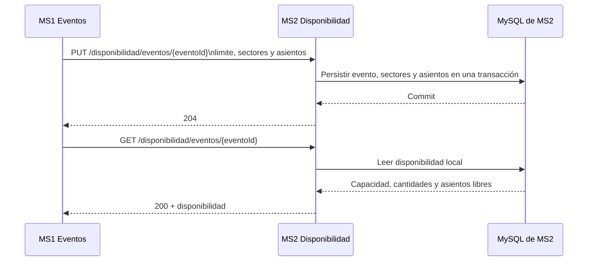
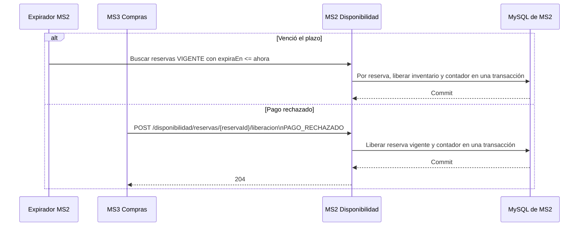
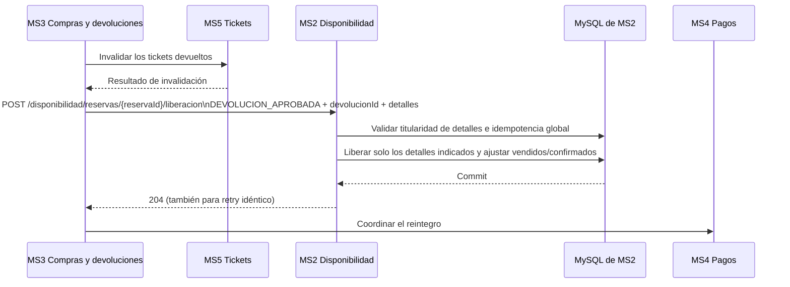
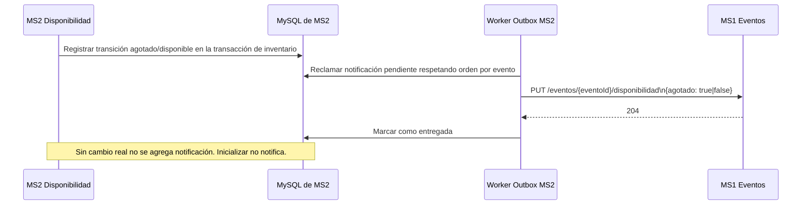

# Flujos principales de MS2

Los diagramas describen las interacciones actualmente documentadas. Las llamadas internas entre microservicios son REST/JSON directas, fuera del Gateway y sin autenticación de servicio. La autorización del cliente corresponde al Gateway, que propaga `X-User-Id` a MS2.

## Inicialización y consulta de disponibilidad



La inicialización deja el evento en `PENDIENTE_PUBLICACION`. MS1 publica ventas enviando `ACTIVA` mediante el endpoint de estado de venta; no hay una notificación adicional de publicación.

## Creación y confirmación de una reserva

```mermaid
sequenceDiagram
    actor Cliente
    participant GW as API Gateway
    participant MS2 as MS2 Disponibilidad
    participant DB as MySQL de MS2
    participant MS3 as MS3 Compras
    participant MS4 as MS4 Pagos
    Cliente->>GW: Solicitar reserva
    GW->>MS2: POST /disponibilidad/eventos/{eventoId}/reservas\nX-User-Id + solicitudId + detalles
    MS2->>DB: Validar límite e inventario; guardar reserva y contadores
    DB-->>MS2: Commit
    MS2-->>GW: 201 (o 200 para retry idéntico vigente)
    GW-->>Cliente: Resultado de reserva
    Cliente->>MS3: Iniciar compra con reservaId
    MS3->>MS2: GET /disponibilidad/reservas/{reservaId}
    MS2-->>MS3: Titular, estado, vencimiento y detalles
    MS3->>MS4: Procesar pago
    MS4-->>MS3: Pago aprobado
    MS3->>MS2: POST /disponibilidad/reservas/{reservaId}/confirmacion
    MS2->>DB: Confirmar y mover reservado a vendido atómicamente
    DB-->>MS2: Commit
    MS2-->>MS3: 204
```

Si el pago fue aprobado pero MS2 no puede confirmar la reserva, MS3 coordina el tratamiento compensatorio con MS4; MS2 no procesa pagos ni compensaciones.

## Liberación por vencimiento o pago rechazado



La expiración y la liberación manual usan el bloqueo de la reserva para evitar transiciones dobles. Las cantidades confirmadas y las ventas no se alteran en estos dos casos.

## Devolución parcial aprobada



El estado de la reserva sigue `CONFIRMADA`. Un `devolucionId` ya aplicado con otra reserva o contenido distinto, o un detalle ya devuelto con otro identificador, produce conflicto sin repetir cambios.

## Notificación de disponibilidad agotada/restaurada por Outbox



El agotamiento se determina por ventas confirmadas, no por reservas temporales, suspensión, cancelación o finalización del evento.
