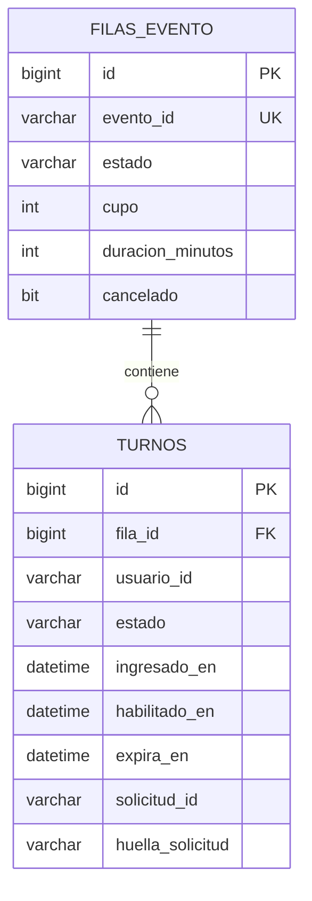

# Gestión de fila virtual

Microservicio **Spring Boot de TicketYa** que administra una fila FIFO por evento para regular el acceso a la creación de reservas. No gestiona inventario ni garantiza que queden entradas: esa responsabilidad corresponde a MS2.

La implementación corresponde al alcance simplificado de la Entrega 2. Persiste filas y turnos en MySQL mediante JPA/Hibernate y administra el esquema con Flyway. La integración saliente con MS1 está implementada contra el contrato acordado y fue probada con un servidor HTTP simulado; el MS1 del repositorio todavía debe completar ese contrato. La integración MS2–MS7 está implementada y fue probada con ambos servicios reales y MS1 simulado; las rutas y seguridad del Gateway siguen pendientes de integración grupal.

## Requisitos

- JDK 21.
- Maven mediante el wrapper incluido (`./mvnw`).
- MySQL 8 compatible con `utf8mb4_0900_bin`; las pruebas de persistencia se ejecutaron con MySQL 8.4.13.
- MS1 disponible y adaptado al contrato de fila virtual para los flujos que lo consultan.
- Docker, si se utiliza una instancia descartable de MySQL para pruebas.

## Levantar la base de datos y el servicio

Ejecutá los comandos desde `Backend/mcsv-fila-virtual`. Prepará previamente una **base propia** `fila_virtual` y un usuario con permisos para que Flyway cree y valide las tablas. No utilices la base de MS2 ni la de otro microservicio. Por defecto MS7 apunta a `localhost:3307/fila_virtual`; ese puerto puede ser utilizado por otra instancia MySQL y no debe suponerse disponible ni descartable.

Configurá la conexión según el entorno:

```bash
export MS7_DB_URL='jdbc:mysql://localhost:3307/fila_virtual'
export MS7_DB_USERNAME='usuario_ms7'
export MS7_DB_PASSWORD='contraseña_del_entorno'
export MS1_API_BASE_URL='http://localhost:8081'
./mvnw spring-boot:run
```

MS7 escucha por defecto en `http://localhost:8088`. Flyway aplica las migraciones y Hibernate valida el esquema con `ddl-auto=validate`. Detené el proceso con `Ctrl+C`; la detención no elimina los datos.

## Configuración

Los valores definidos en `src/main/resources/application.properties` son:

| Variable | Valor predeterminado | Uso |
|---|---|---|
| `SERVER_PORT` | `8088` | Puerto HTTP de MS7. |
| `MS7_DB_URL` | `jdbc:mysql://localhost:3307/fila_virtual` | URL JDBC de la base propia. |
| `MS7_DB_USERNAME` | `root` | Usuario de MySQL. |
| `MS7_DB_PASSWORD` | vacío | Contraseña suministrada por el entorno. |
| `MS7_TURNOS_FIXED_DELAY_MS` | `60000` | Intervalo entre el final de un barrido y el inicio del siguiente. |
| `MS1_API_BASE_URL` | `http://localhost:8081` | Dirección interna de MS1. |
| `MS1_API_CONNECT_TIMEOUT_MS` | `2000` | Timeout de conexión HTTP con MS1. |
| `MS1_API_READ_TIMEOUT_MS` | `5000` | Timeout de lectura HTTP con MS1. |

La configuración por defecto muestra SQL (`spring.jpa.show-sql=true`) y rechaza propiedades JSON desconocidas. Sustituí las credenciales locales por variables del entorno de ejecución. Dentro de contenedores, la URL de MS1 y de MySQL debe apuntar a los nombres de servicio y puertos internos correspondientes.

## Arquitectura y paquetes

| Paquete | Responsabilidad |
|---|---|
| `controller` | Endpoints públicos e internos, identidad propagada, roles y manejo de errores. |
| `dto` | Records de entrada y salida, validaciones y formato de errores. |
| `service` | Reglas de negocio, transacciones, scheduler y coordinación HTTP con MS1. |
| `repository` | Consultas JPA, selección de candidatas y bloqueos pesimistas. |
| `model` y `model.enums` | Entidades `FilaEvento`, `Turno` y sus estados. |
| `config` | Reloj UTC inyectable. |
| `src/main/resources/db/migration` | Migraciones Flyway de la base propia. |

## Modelo de datos

`FilaEvento` almacena el identificador externo del evento, el estado administrativo, el cupo, la duración en minutos y la marca terminal `cancelado`. Existe como máximo una fila por evento. `Turno` pertenece a una fila y conserva usuario, estado, fechas y, cuando fue consumido, `solicitudId` y huella. Las referencias a eventos y usuarios son identificadores externos, sin claves foráneas a otras bases.



La migración restringe estados, fechas, cupo y duración. Una columna generada y un índice único impiden dos turnos activos del mismo usuario en una fila; otro índice único protege `(usuario_id, solicitud_id)`, incluso entre eventos. Los identificadores y claves usan comparación exacta `utf8mb4_0900_bin`. Hay índices para FIFO, vencimientos y selección por estado. Los valores `DATETIME(6)` se manejan con semántica UTC.

## Estados y funcionamiento

### Estado de la fila

| Estado | Comportamiento |
|---|---|
| `ACTIVA` | Permite ingresos, habilitaciones y consumo. |
| `PAUSADA` | No crea ingresos ni habilita turnos nuevos; permite recuperar un turno activo y consumir uno habilitado vigente. Solo se pausa una fila activa o se repite una pausa ya aplicada. |
| `DESACTIVADA` | No admite ingresos ni consumo nuevo; los turnos que esperaban o estaban habilitados se invalidan como `VENCIDO`. |

La cancelación se registra en `cancelado`, desactiva la fila, invalida turnos activos y no modifica los consumidos. Una cancelación registrada impide la reactivación local. Repetir la notificación de cancelación es idempotente.

### Estado del turno

| Estado | Significado |
|---|---|
| `ESPERANDO` | En espera de un cupo. |
| `HABILITADO` | Puede consumirse hasta `expiraEn`. |
| `CONSUMIDO` | Consumido para una solicitud identificada; su registro se conserva. |
| `VENCIDO` | La habilitación venció o el turno activo fue invalidado. |

El ingreso de un cliente con turno activo devuelve el existente; si no tiene uno y la fila está activa, crea otro. La posición para `ESPERANDO` comienza en 1 y cuenta los turnos que esperan antes en la misma fila. Es una instantánea. Los demás estados no incluyen `posicion` en la respuesta.

El orden FIFO se establece mediante el ID persistente de ingreso dentro de cada fila. La transacción bloquea primero la fila del evento. El cupo predeterminado es 10 y la duración inicial es 5 minutos, ambos configurables por evento. Al aumentar el cupo se habilitan clientes por orden; al reducirlo no se revocan habilitados. La duración modificada se aplica a nuevas habilitaciones, sin alterar vencimientos ya asignados.

## Vencimiento y scheduler

Un turno habilitado vence lógicamente cuando `expiraEn <= ahora`. El consumo comprueba el vencimiento aun si el scheduler no ha procesado el turno. El scheduler usa Spring Scheduler con `fixedDelay`, selecciona filas con habilitaciones vencidas **o** filas activas con espera y cupo disponible, y procesa cada candidata por separado.

Cada procesamiento adquiere el bloqueo de la fila, vuelve a comprobar su estado y vence turnos; si está activa y no cancelada, habilita por FIFO hasta el cupo. En pausa puede vencer turnos, pero no habilita nuevos. Un error en una fila se registra y no detiene las demás. El intervalo no garantiza que un turno se procese exactamente dentro de 60 segundos; hay procesamiento oportunista en operaciones locales y barridos posteriores para recuperar trabajo.

## Transacciones, concurrencia e idempotencia

Las operaciones locales usan transacciones nuevas con `READ_COMMITTED`, bloqueo pesimista de la fila y recarga del estado bajo bloqueo. Las restricciones de base son una defensa adicional para varias instancias conectadas a la misma base. No se mantienen bloqueos locales durante llamadas HTTP a MS1.

MS2 solicita a MS7 el consumo con `usuarioId`, `solicitudId` y `huellaSolicitud`. La clave es `(usuarioId, solicitudId)`, también entre eventos. Un reintento idéntico recupera el consumo histórico sin consumir un turno nuevo; una clave con evento o huella incompatibles produce conflicto. Ante una carrera de unicidad, el servicio busca al ganador después del rollback, en una transacción nueva.

`autorizacionVigente` es `true` si el vencimiento original todavía no llegó, la fila no está desactivada y el evento no fue cancelado localmente. Recuperar un consumo no demuestra que exista una reserva. MS2 recupera primero una reserva vigente existente y comprueba `expiraEn` antes de iniciar una reserva nueva. No hay transacción distribuida: se acepta que un turno consumido pueda no producir una reserva ante ciertos fallos. Un timeout no restaura el turno automáticamente.

También se acepta la ventana en que una fila se desactiva o cancela después de que MS7 respondió con una autorización vigente y antes de que MS2 complete la reserva local. La comprobación posterior del vencimiento en MS2 no vuelve a consultar el estado remoto de la fila.

Si MS1 informa que el evento no requiere fila virtual, el ingreso se rechaza y el mensaje indica que el cliente puede reservar directamente.

## Endpoints

MS7 utiliza `http://localhost:8088` como URL local. El contrato detallado, con validaciones, códigos y ejemplos, está en [docs/openapi/ms7.yaml](docs/openapi/ms7.yaml).

### Públicos: Gateway → MS7

| Método | Ruta | Rol |
|---|---|---|
| POST | `/filas/eventos/{eventoId}/ingresos` | `CLIENTE` |
| GET | `/filas/eventos/{eventoId}/mi-turno` | `CLIENTE` |
| GET | `/filas/eventos/{eventoId}` | `ORGANIZADOR` propietario o `ADMIN` |
| PUT | `/filas/eventos/{eventoId}/configuracion` | `ORGANIZADOR` propietario o `ADMIN` |
| PUT | `/filas/eventos/{eventoId}/estado` | `ORGANIZADOR` propietario o `ADMIN` |

Gateway debe validar el JWT, eliminar los encabezados de identidad externos y propagar `X-User-Id` y `X-User-Roles` separados por comas. MS7 comprueba esos encabezados y roles, pero no valida por sí mismo el JWT. El ingreso comprueba en MS1 que el evento no esté cancelado ni finalizado y que requiera fila. Las consultas y operaciones administrativas consultan MS1 para verificar el evento y, cuando corresponde, su propietario.

La consulta y la actualización de política a MS1 usan circuitos independientes de Resilience4j 2.4.0: ventana de 10 llamadas, mínimo de 5, umbral del 50 % y espera de 30 segundos, definidos en código. La consulta GET reintenta una vez errores transitorios después de 100 ms; el PUT no tiene reintentos automáticos. Los timeouts HTTP configurables conservan los valores predeterminados de 2 segundos de conexión y 5 de lectura. Un circuito abierto se trata como indisponibilidad de MS1, sin autorizar operaciones que requieran su comprobación.

El entorno de integración aislado se ejecuta desde MS2 con `sh tests/integracion/ejecutar-compose.sh`. Usa dos instancias reales de cada servicio, bases separadas y MS1 simulado; las pruebas contra MS1 y Gateway reales siguen siendo integración grupal.

La integración comprueba FIFO y liberación de cupo, ingresos concurrentes entre instancias, vencimiento real, consumo con fallo definitivo de reserva y reingreso. Un proxy de pruebas permite perder una respuesta de consumo real y simular indisponibilidad de MS7 sin detener la instancia; no sustituye la validación con las dependencias grupales reales.

La [matriz de cumplimiento individual](../mcsv-disponibildad-reservas/documentacion/Matriz-Cumplimiento-Entrega-2.md) distingue las verificaciones de MS2 y MS7 de las integraciones grupales pendientes y las limitaciones aceptadas.

Una identidad ausente o inválida responde `401`; una identidad válida con roles ausentes, inválidos o insuficientes responde `403`.

Ejemplo de respuesta a un ingreso nuevo (`201`; un ingreso activo repetido devuelve `200`):

```json
{
  "turnoId": 125,
  "eventoId": "evento-123",
  "estado": "HABILITADO",
  "ingresadoEn": "2026-11-17T15:00:00Z",
  "habilitadoEn": "2026-11-17T15:00:00Z",
  "expiraEn": "2026-11-17T15:05:00Z"
}
```

Para configurar una fila, el cuerpo completo es:

```json
{"cupo": 10, "duracionMinutos": 5}
```

Para cambiar su estado:

```json
{"estado": "ACTIVA"}
```

### Internos

| Método | Ruta | Consumidor previsto |
|---|---|---|
| POST | `/internal/filas/eventos/{eventoId}/consumos` | MS2 |
| PUT | `/internal/filas/eventos/{eventoId}/cancelacion` | MS1 |

El consumo recibe:

```json
{"usuarioId": "cliente-123", "solicitudId": "SOL-9b8d", "huellaSolicitud": "v1:huella"}
```

Ejemplo de respuesta:

```json
{
  "turnoId": 125,
  "eventoId": "evento-123",
  "solicitudId": "SOL-9b8d",
  "estado": "CONSUMIDO",
  "expiraEn": "2026-11-17T15:05:00Z",
  "autorizacionVigente": true
}
```

Las rutas internas no validan individualmente la identidad del servicio llamador. Deben quedar fuera del Gateway y accesibles solo desde la red privada acordada; esa protección de despliegue todavía debe integrarse.

## Validaciones y errores

`cupo` y `duracionMinutos` son enteros positivos obligatorios. `estado` debe ser un valor de `EstadoFila`. Los campos de consumo son obligatorios y admiten entre 1 y 255 puntos de código Unicode; no se normalizan. El servicio valida que `eventoId` no sea blanco y no supere 255 unidades UTF-16. El campo `campos` de error se omite cuando no corresponde.

```json
{
  "timestamp": "2026-11-17T15:00:00Z",
  "status": 400,
  "error": "Bad Request",
  "mensaje": "La solicitud contiene datos inválidos.",
  "campos": [{"campo": "cupo", "mensaje": "debe ser mayor que 0"}]
}
```

Se utilizan `400`, `401`, `403`, `404`, `409`, `415`, `500` y `503` según el caso, además de `200`, `201` y `204` para éxito. `503` indica que no se pudo verificar o confirmar una dependencia de MS1; no demuestra que un `PUT` remoto no se haya aplicado.

## Comunicación con MS1 y MS2

MS7 consulta `GET /internal/eventos/{eventoId}` de MS1 y espera `eventoId`, `estado`, `organizadorId` cuando deba verificar propiedad y `requiereFila` cuando deba verificar la política. Para activación y desactivación llama a `PUT /internal/eventos/{eventoId}/politica-fila` con `{"requiereFila": true}` o `false`. Pausa y reanudación no envían ese `PUT`.

En activación, MS7 prepara la configuración local, solicita `true` a MS1 y activa localmente tras la confirmación. En desactivación, cierra la fila e invalida turnos locales antes de solicitar `false`. Si la respuesta es incierta, no se informa éxito y puede repetirse el mismo cambio idempotentemente.

**Pendiente en MS1 real:** agregar `organizadorId` y `requiereFila` a la respuesta interna, implementar el `PUT` de política y notificar la cancelación a MS7. **MS2 implementa** la consulta de política y el consumo del turno. Se verificó el flujo con MS2 y MS7 reales y MS1 simulado; falta la prueba grupal con MS1 y Gateway reales.

La coordinación simplificada acepta indisponibilidad temporal ante fallos. No deben ejecutarse cambios administrativos opuestos simultáneamente sobre un evento: debe resolverse el anterior antes de iniciar otro. No se incorporan preautorizaciones, operaciones de reserva adicionales, generaciones, políticas versionadas, outbox para fila ni transacciones distribuidas.

## Pruebas automatizadas

La suite ordinaria se ejecuta con:

```bash
./mvnw test
```

Las pruebas MySQL son opt-in: sin `MS7_TEST_MYSQL_URL` se omiten. **El ejecutor debe crear y verificar una instancia descartable nueva, sin volúmenes existentes.** Las pruebas borran filas de `turnos` y `filas_evento`; no deben apuntarse a bases de desarrollo. La validación de URL y puerto ayuda a evitar errores, pero no demuestra que una instancia sea descartable.

Ejemplo para una ejecución aislada con un contenedor nuevo y un puerto local aleatorio:

```bash
docker run --detach --rm --name ms7-mysql-pruebas \
  --publish 127.0.0.1::3306 \
  --env MYSQL_ROOT_PASSWORD=ms7_prueba_temporal \
  --env MYSQL_DATABASE=ms7_disposable mysql:8.4

# Esperar a que MySQL acepte conexiones; obtener el puerto asignado:
docker port ms7-mysql-pruebas 3306/tcp
```

Con el puerto mostrado, distinto de `3307`, y tras verificar que el contenedor es la instancia nueva:

```bash
export MS7_TEST_MYSQL_URL='jdbc:mysql://127.0.0.1:PUERTO/ms7_disposable'
export MS7_TEST_MYSQL_PASSWORD='ms7_prueba_temporal'
./mvnw test
docker stop ms7-mysql-pruebas
```

Sustituí `PUERTO` por el asignado. El `docker stop` anterior se refiere únicamente al contenedor creado para esta ejecución; `--rm` lo elimina al detenerlo.

La última validación individual aprobó **59 pruebas**, sin fallos ni omisiones, con MySQL 8.4 aislado. Una validación histórica anterior aprobó 52 pruebas; las ejecuciones posteriores añadieron cobertura de resiliencia y trazabilidad. Estos resultados históricos no sustituyen una prueba integrada con los demás servicios.

## Ejecución mediante Docker

Desde este directorio ejecutá `docker build -t ticketya-ms7 .`. La construcción es multietapa con Java 21 y el proceso se ejecuta con un usuario sin privilegios. La imagen escucha internamente en el puerto 8088; el Dockerfile no publica puertos.

Suministrá `MS7_DB_URL`, `MS7_DB_USERNAME` y `MS7_DB_PASSWORD` desde el entorno o un gestor de secretos, y conectá el servicio a una base MySQL propia. Configurá `MS1_API_BASE_URL` con la dirección interna de MS1: `localhost` dentro del contenedor apunta al mismo contenedor. También pueden configurarse `SERVER_PORT`, `MS7_TURNOS_FIXED_DELAY_MS`, `MS1_API_CONNECT_TIMEOUT_MS` y `MS1_API_READ_TIMEOUT_MS` según la tabla anterior. Flyway aplica la migración inicial y Hibernate valida el esquema al arrancar. No se deben incluir credenciales reales en la imagen.

Por ejemplo, con la red interna y los servicios `mysql-ms7` y `ms1` ya disponibles, exportá `MS7_DB_USERNAME` y `MS7_DB_PASSWORD` desde el entorno seguro y ejecutá:

```bash
docker run --rm --name ticketya-ms7 --network ticketya-interna \
  -e 'MS7_DB_URL=jdbc:mysql://mysql-ms7:3306/fila_virtual' \
  -e MS7_DB_USERNAME -e MS7_DB_PASSWORD \
  -e 'MS1_API_BASE_URL=http://ms1:8081' ticketya-ms7
```

Los nombres y la red son ejemplos que deben coincidir con el despliegue real.

La colección individual [Postman](postman/TicketYa-MS7.postman_collection.json) contiene los siete endpoints; las operaciones internas se deben ejecutar únicamente en entornos confiables. Las pruebas con MS1 simulado no sustituyen la verificación con los servicios reales.

## Correlación de solicitudes

MS7 acepta `X-Correlation-Id` con 1 a 128 caracteres alfanuméricos, punto, guion, guion bajo o dos puntos. Si falta o no cumple el formato, genera un UUID. Devuelve el identificador en el encabezado de respuesta, incluso en errores; lo incorpora al MDC para los logs y lo propaga en las consultas y actualizaciones sincrónicas a MS1. El contexto se limpia al finalizar la solicitud. Las tareas programadas no heredan la correlación de solicitudes terminadas.

El registro HTTP incluye método, operación, estado, duración y, cuando se validaron identidad y rol, usuario; las solicitudes internas y las identidades no validadas se registran sin usuario. La centralización con Alloy, Loki y Grafana queda pendiente de integración grupal. Hibernate no imprime SQL por defecto; para diagnóstico se puede establecer `SPRING_JPA_SHOW_SQL=true`.
