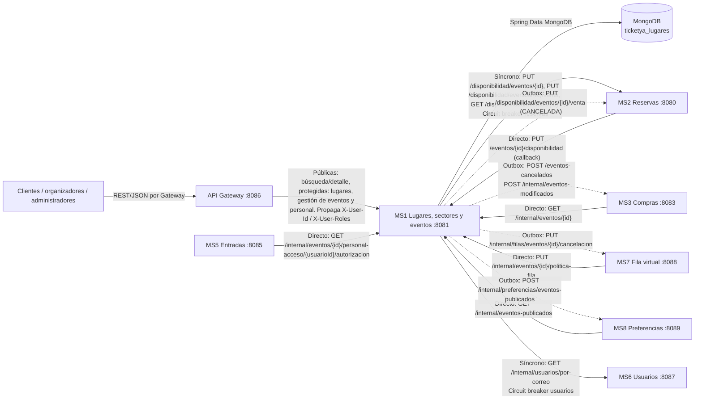
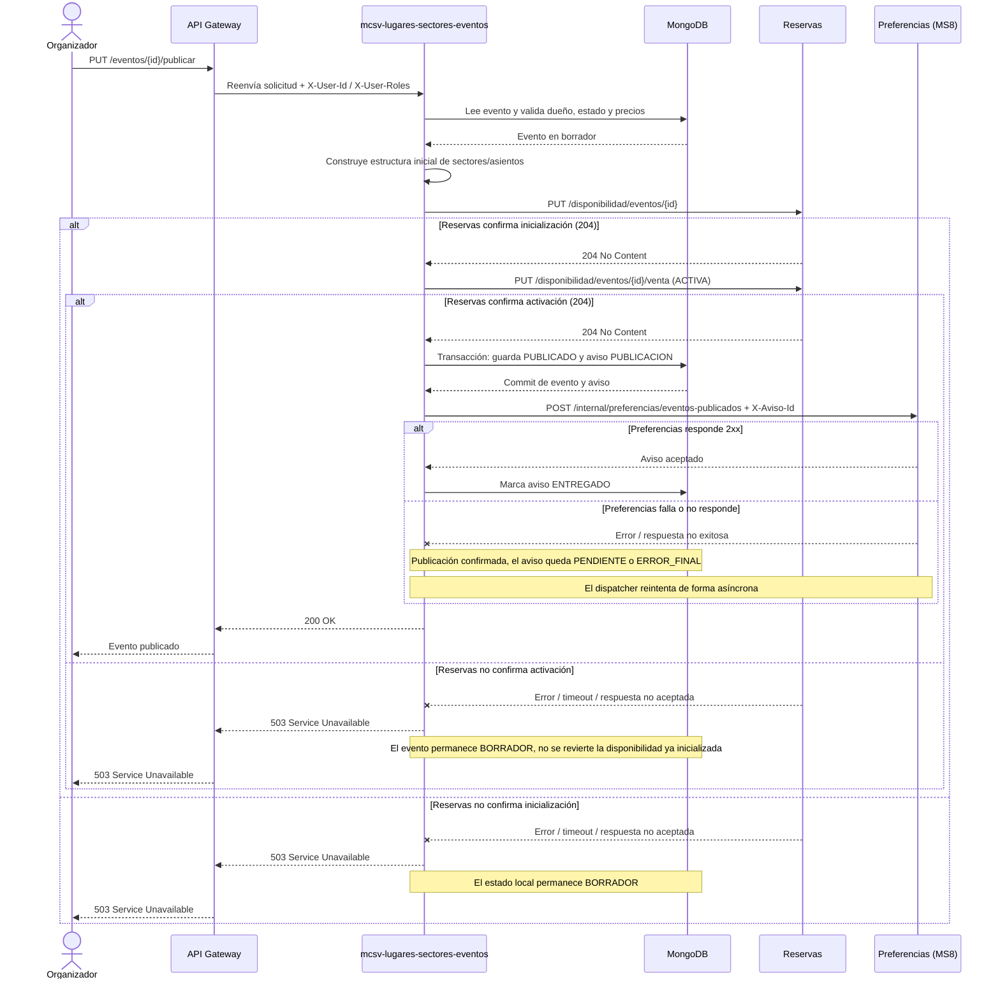
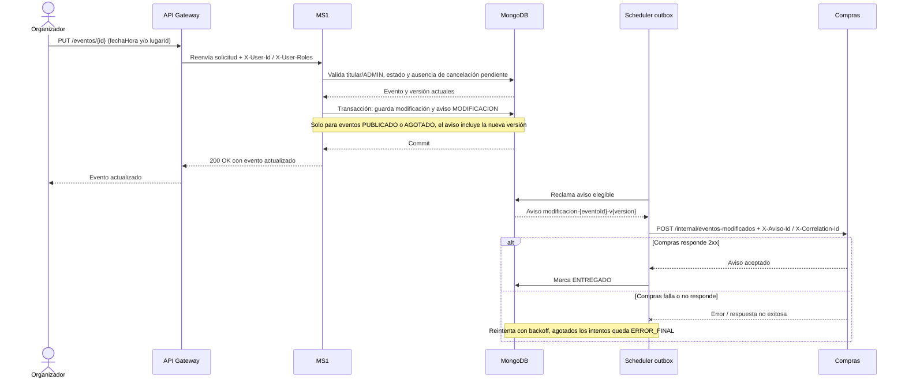
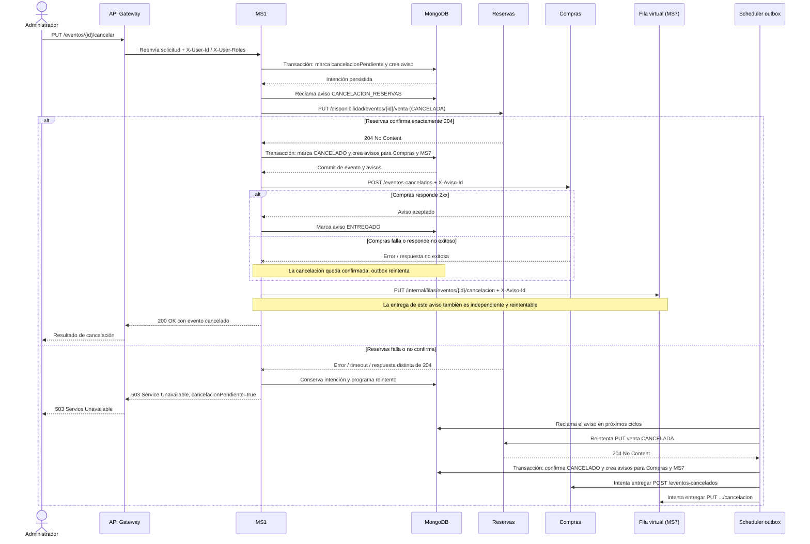
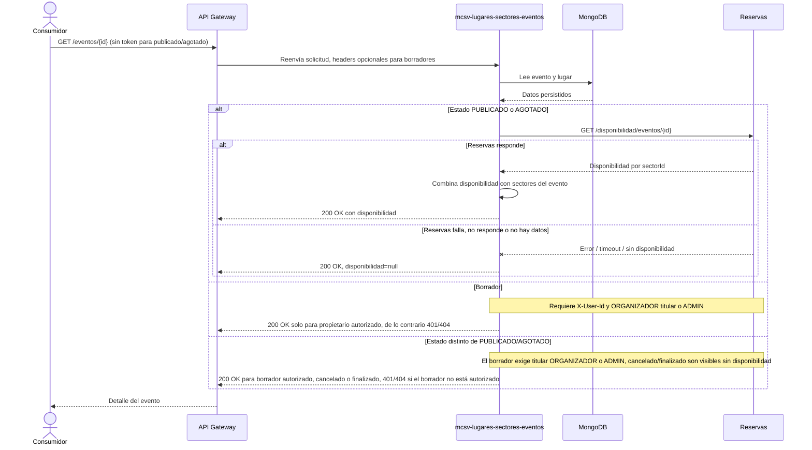
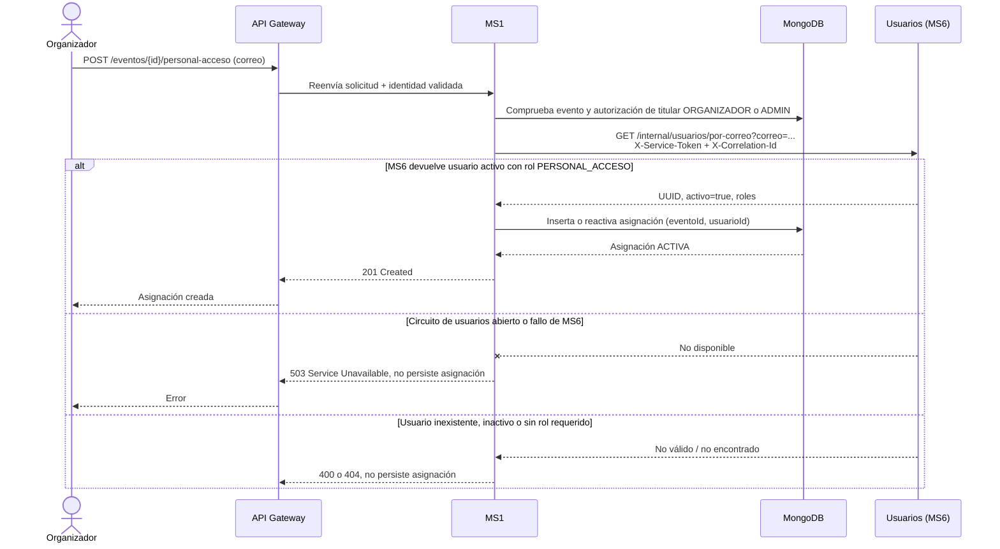

# Diseño de mcsv-lugares-sectores-eventos

## Responsabilidades y límites

Este microservicio administra:

- Lugares físicos y sus sectores, numerados o no numerados.
- Eventos asociados a un lugar, incluidos los sectores del evento copiados del lugar.
- Precios por sector y el límite de entradas por cliente.
- El ciclo de vida del evento: borrador, publicación, suspensión/reactivación de venta, cancelación, agotamiento y finalización.
- La política de fila del evento y la asignación, revocación y consulta interna de personal de acceso.
- Búsqueda paginada y ordenada de eventos publicados o agotados, y consulta de detalle.

No es responsable de administrar inventario/disponibilidad ni reservas, procesar compras o devoluciones, autenticar usuarios ni administrar la fila virtual. La disponibilidad se consulta en Reservas y se refleja localmente a partir de su callback. MS1 consulta MS6 para validar personal por correo y MS5 consulta la autorización vigente de cada asignación. En las rutas protegidas, el Gateway valida el JWT y propaga `X-User-Id` con el claim `sub` y `X-User-Roles` como lista separada por comas; MS1 aplica autorización por rol/propiedad, pero no valida credenciales ni JWT. Las operaciones entre servicios son directas, no pasan por el Gateway.

La API publicada por el Gateway incluye las rutas públicas de búsqueda y detalle de eventos (los borradores siguen requiriendo identidad) y las rutas protegidas de lugares/sectores, administración de eventos y personal de acceso. El Gateway valida el JWT y reenvía `X-User-Id`/`X-User-Roles`. El resumen de rutas está en el [README](../README.md#endpoints); la especificación interactiva está en [Swagger UI](http://localhost:8081/swagger-ui/index.html) cuando el servicio local está iniciado. Las rutas `/internal/**` y el callback de disponibilidad no se publican.

## Componentes e integración local

Los puertos corresponden al [compose general](../../../docker-compose.yml) y a los compose de cada servicio. Las flechas continuas son llamadas síncronas; las punteadas representan avisos en outbox. Las rutas de MS1 expuestas a clientes pasan por el Gateway. Las rutas internas entrantes y las llamadas salientes de MS1 son directas entre servicios y no pasan por él. Las llamadas de outbox y la consulta de usuarios usan `X-Service-Token`; las llamadas salientes propagan `X-Correlation-Id` y las entregas outbox también `X-Aviso-Id`.

Por el Gateway, `GET /eventos` y `GET /eventos/{eventoId}` son públicos (excepto el detalle de borradores); las rutas de lugares/sectores, escritura y ciclo de vida de eventos y `/eventos/{eventoId}/personal-acceso` son protegidas. Reservas, Compras, MS5, MS7 y MS8 consumen las rutas internas directamente.

## Secuencias del ciclo de vida y consulta

### Publicar un evento

Para sectores numerados, la solicitud a Reservas incluye los pares `(fila, numero)` derivados de las dimensiones del sector. Un reintento puede volver a inicializar con el mismo contenido; el contrato espera que esa repetición sea idempotente.

### Modificar fecha o lugar de un evento

La modificación no cambia los sectores, precios ni disponibilidad del evento. El aviso se crea en la misma transacción que el cambio; la entrega no forma parte de la respuesta HTTP de modificación.

### Consultar eventos para Preferencias

MS8 consulta directamente `GET /internal/eventos-publicados`, sin headers de usuario y fuera del Gateway. La respuesta paginada contiene solo eventos `publicado` o `agotado` y los campos `eventoId`, `nombre`, `tipo`, `participantes`, `ciudad`, `fechaHora` UTC y `estado`. `page` inicia en cero; `size` usa 100 por defecto, con máximo 200. La consulta ordena por fecha e ID del evento para conservar el orden entre páginas. Los parámetros inválidos responden `400`.

### Cancelar un evento

La primera petición registra una intención durable antes de llamar a Reservas. Hasta que Reservas confirme con `204`, el estado local no cambia a `CANCELADO`; la respuesta de la petición es `503` si queda pendiente. El dispatcher y el scheduler reintentan el aviso `CANCELACION_RESERVAS`; al confirmarlo, el evento y los avisos a Compras/MS7 se guardan en una única transacción. Los fallos de estos avisos posteriores no revierten la cancelación.

### Consultar el detalle y su disponibilidad

### Asignar personal de acceso

MS5 consulta después la autorización vigente directamente en `GET /internal/eventos/{eventoId}/personal-acceso/{usuarioId}/autorizacion`, sin pasar por el Gateway ni usar caché. La revocación conserva el documento como `REVOCADA`; una asignación revocada puede reactivarse.

## Decisiones de diseño

| Decisión | Justificación y evidencia |
|---|---|
| MongoDB desde la Entrega 1 | El código usa MongoDB (`spring-boot-starter-data-mongodb`) y declara las colecciones `lugares`, `eventos`, `outbox` y `personal_acceso`; Mongo se ejecuta en el compose del servicio y el compose general. |
| Confirmación remota antes del cambio local | Publicación, suspensión, reactivación y finalización actualizan el estado local solo después de la confirmación correspondiente de Reservas. La cancelación es recuperable: registra primero una intención durable y solo cambia a `CANCELADO` cuando Reservas confirma exactamente `204`; mientras está pendiente responde `503`. |
| Avisos a servicios mediante outbox transaccional | Publicación (`PUBLICACION`), cancelación confirmada (`CANCELACION`), cancelación de fila (`CANCELACION_FILA`) y modificación (`MODIFICACION`) persisten avisos junto con el cambio local, cuando aplica. La cancelación recuperable también guarda la intención y su tarea de confirmación en outbox antes de llamar a Reservas. Los avisos usan `X-Service-Token`, `X-Aviso-Id` y `X-Correlation-Id`; los errores temporales se reintentan y los definitivos o agotados quedan `ERROR_FINAL`. |
| Índices de outbox | `_id_` único garantiza que no se repita el ID del aviso. `idx_outbox_estado_proximo_intento` (`estado`, `proximoIntento`, `intentos`) selecciona pendientes vencidos; `idx_outbox_estado_lease` (`estado`, `leaseHasta`, `intentos`) recupera leases vencidos y apoya el barrido de intentos agotados. |
| Control optimista de concurrencia por versión | `Lugar` y `Evento` declaran `@Version`. Las escrituras concurrentes con una versión obsoleta no pisan silenciosamente el documento; se traducen a conflicto de actualización. |
| Identidad propagada por el Gateway, sin autenticación local | El Gateway valida el JWT y envía el claim `sub` como `X-User-Id` y la lista de roles como `X-User-Roles`. El microservicio evalúa todos los roles sin precedencia arbitraria y aplica además la titularidad; no valida el token directamente. |
| Comunicación directa entre servicios, fuera del Gateway | Las llamadas REST y rutas internas se dirigen al servicio de destino sin pasar por el Gateway. El callback de Reservas y las rutas internas de Compras, MS5, MS7 y MS8 no se exponen públicamente. MS6 y las entregas outbox se autentican con `X-Service-Token`; el callback de Reservas y la actualización de política de fila no exigen identidad de usuario ni token de servicio. |
| Copiar datos entre colecciones/servicios cuando se necesita una instantánea | Al crear un evento se copian la ciudad y los datos de sectores del lugar; los precios se asignan al evento. Al publicar se envían a Reservas las dimensiones/capacidad y los asientos derivados. Compras recibe una respuesta interna con los nombres y precios actuales del evento y sector. La copia de ciudad y sectores está verificada en `EventoService`; las persistencias de Reservas y Compras quedan fuera del código de este repositorio. Ver también [modelo de datos](./modelo-de-datos.md). |

## Limitaciones conocidas

- `ERROR_FINAL` requiere revisión directa en MongoDB; no existe un endpoint para reprocesar manualmente avisos.
- Si se agotan los intentos del aviso `CANCELACION_RESERVAS`, la cancelación queda pendiente hasta intervención operativa.
- El dispatcher limita cada pasada a 100 avisos. Un lease vencido permite recuperar un reclamo; el destino puede recibir una reentrega con el mismo `X-Aviso-Id` y debe tolerar duplicados.

## Resiliencia de dependencias

- **Timeouts síncronos:** Reservas y MS6 usan 2 s de conexión y 5 s de lectura. Para Reservas son configurables con `RESERVAS_CONNECT_TIMEOUT` y `RESERVAS_READ_TIMEOUT`; MS6 define esos valores en su cliente HTTP. Las entregas outbox usan 2 s de conexión y 5 s de lectura (Reservas usa la configuración anterior).
- **Outbox y reintentos:** el dispatcher corre cada 60 s por defecto, reclama hasta 100 avisos por pasada y usa un lease de 60 s. Los fallos de transporte, `408`, `429` y `5xx` se reintentan hasta 8 intentos, con espera exponencial desde 30 s hasta 15 min. Los errores definitivos y los intentos agotados pasan a `ERROR_FINAL`. La entrega inmediata de publicación/cancelación no sustituye al scheduler de recuperación.
- **Cancelación recuperable:** antes de cambiar el estado local a `CANCELADO`, MS1 guarda `cancelacionPendiente` y una tarea outbox para confirmar la venta cancelada en Reservas. Solo un `204` confirma la cancelación; hasta entonces el endpoint responde `503` y la intención queda para reintento. Los avisos posteriores a Compras y MS7 se crean con el commit de cancelación y fallan independientemente.
- **Circuit breakers síncronos:** hay dos circuitos independientes, `reservas` y `usuarios`. Cada uno usa ventana por cantidad de 10 llamadas, mínimo de 10 llamadas, umbral de fallas del 50 %, apertura de 30 s y una llamada permitida en semiabierto. El umbral de llamada lenta es 365 días, por lo que las fallas de transporte/HTTP son las que determinan la apertura en la práctica. Las respuestas HTTP `4xx` remotas se excluyen del cómputo. `reservas` protege consulta de disponibilidad, publicación, suspensión y reactivación; `usuarios` protege la validación de personal por correo. Outbox, cancelación recuperable y finalización programada no usan estos circuitos.
- **Salud y eventos:** las transiciones se registran en `WARN`; `/actuator/health` expone `circuitbreakers.reservas` y `circuitbreakers.usuarios`. Un circuito abierto no hace fallar el health global (`allow-health-indicator-to-fail: false`).

## Trazabilidad de solicitudes

MS1 valida o genera `X-Correlation-Id`, lo devuelve en la respuesta, lo mantiene en MDC y lo agrega al log de acceso junto con método, ruta sin query, usuario si existe, estado HTTP y duración. Las llamadas salientes propagan la correlación; los avisos outbox guardan el ID y lo reutilizan al reintentar. No se registran tokens, cuerpos ni contraseñas. En el [compose general](../../../docker-compose.yml), Alloy envía los logs de contenedores a Loki y Grafana los presenta en el dashboard **TicketYa - Logs** (`http://localhost:3000`), que permite buscar por `correlationId`.

## Trazabilidad de OpenSpec a pruebas

Las capacidades de la tabla corresponden a `openspec/specs`; la cobertura enumera clases de prueba relacionadas, no afirma que cada escenario de una spec corresponda a un único test.

| Spec | Capacidad | Clases de prueba |
|---|---|---|
| `lugares-y-sectores` | Registrar lugares con datos válidos | `LugarControllerTest`, `LugarApiEndToEndTest`, `LugarServiceTest` |
| `lugares-y-sectores` | Registrar sectores numerados | `LugarControllerTest`, `LugarApiEndToEndTest`, `LugarServiceTest`, `AsientoNumeradoTest` |
| `lugares-y-sectores` | Registrar sectores no numerados | `LugarControllerTest`, `LugarApiEndToEndTest`, `LugarServiceTest` |
| `lugares-y-sectores` | Consultar lugares y sectores | `LugarControllerTest`, `LugarApiEndToEndTest`, `DevSampleDataIntegrationTest` |
| `lugares-y-sectores` | Normalizar rol administrativo de lugares/sectores | `LugarControllerTest` |
| `lugares-y-sectores` | Responder errores inesperados de forma segura | `LugarControllerTest`, `LugarApiEndToEndTest` |
| `eventos` | Crear eventos en borrador | `EventoServiceTest`, `EventoControllerTest` |
| `eventos` | Definir límite de entradas por cliente | `EventoServiceTest`, `EventoControllerTest`, `EventoLifecycleServiceTest` |
| `eventos` | Definir precios por sector en borrador | `EventoServiceTest`, `EventoControllerTest` |
| `eventos` | Publicar eventos con disponibilidad inicializada | `EventoLifecycleServiceTest`, `EventoControllerTest`, `HttpReservasClientTest` |
| `eventos` | Administrar suspensión, reactivación y cancelación | `EventoLifecycleServiceTest`, `ComprasCancellationFlowTest`, `EventoCancelacionOutboxIntegrationTest` |
| `eventos` | Persistir y entregar avisos outbox | `OutboxAvisoRepositoryMongoTest`, `OutboxDispatcherTest`, `OutboxSchedulerTest`, `RestClientOutboxHttpClientTest`, `EventoCancelacionOutboxIntegrationTest`, `EventoPublicacionOutboxIntegrationTest` |
| `eventos` | Reflejar automáticamente disponibilidad y finalización | `EventoLifecycleServiceTest`, `EventoServiceTest`, `EventoControllerTest` |
| `eventos` | Ofrecer a Compras una consulta interna del evento | `EventoControllerTest` |
| `eventos` | Ofrecer a Preferencias una consulta interna de eventos publicados | `EventoControllerTest`, `EventoConsultaServiceTest`, `EventoRepositoryMongoTest` |
| `eventos` | Mantener estados y formato de errores acordados | `EventoServiceTest`, `EventoControllerTest`, `OpenApiDocumentationTest` |
| `eventos` | Compartir identidad de asiento con Reservas | `AsientoNumeradoTest`, `EventoLifecycleServiceTest`, `HttpReservasClientTest` |
| `eventos` | Buscar eventos publicados y agotados | `EventoConsultaServiceTest`, `EventoConsultaControllerTest`, `EventoRepositoryMongoTest` |
| `eventos` | Ordenar y paginar la búsqueda de eventos | `EventoConsultaServiceTest`, `EventoConsultaControllerTest`, `EventoRepositoryMongoTest` |
| `eventos` | Consultar el detalle público de un evento | `EventoConsultaServiceTest`, `EventoConsultaControllerTest` |
| `eventos` | Incluir disponibilidad de Reservas en el detalle público | `EventoDetalleDisponibilidadIntegrationTest`, `HttpReservasClientTest`, `EventoControllerTest` |
| `eventos` | Normalizar rol administrativo del ciclo de vida | `EventoLifecycleServiceTest`, `EventoControllerTest`, `EventoConsultaServiceTest` |
| `eventos` | Responder errores inesperados de forma segura | `EventoControllerTest`, `EventoConsultaControllerTest`, `OpenApiDocumentationTest` |
| `eventos` | Actualizar fecha/lugar y notificar a Compras con versión | `EventoServiceTest`, `ModificacionOutboxIntegrationTest`, `OutboxDispatcherTest` |
| `eventos` | Recuperar cancelaciones e informar a Compras/MS7 | `CancelacionRecuperableIntegrationTest`, `EventoCancelacionOutboxIntegrationTest`, `ComprasCancellationFlowTest` |
| `eventos` | Mantener política de fila para MS7 | `PoliticaFilaIntegrationTest`, `EventoControllerTest` |
| `personal-acceso` | Autorizar, validar por correo en MS6, asignar/reactivar, listar y revocar | `PersonalAccesoIntegrationTest`, `HttpUsuariosClientTest` |
| `personal-acceso` | Consultar autorización actual sin caché para MS5 | `PersonalAccesoIntegrationTest` |
| `errores-http` | Formato de errores HTTP de rutas/contenido y correlación en errores | `OpenApiDocumentationTest`, `LugarControllerTest`, `EventoControllerTest`, `CorrelacionFilterTest` |
| `resiliencia-clientes-sincronicos` | Aislar circuitos, umbrales, 4xx ignorados, degradación y health | `CircuitBreakerConfigurationTest`, `ReservasSincronoTest`, `HttpReservasClientTest`, `HttpUsuariosClientTest`, `PersonalAccesoIntegrationTest` |
| `trazabilidad-correlacion` | Generar, propagar y registrar correlación, también en outbox | `CorrelacionFilterTest`, `HttpReservasClientTest`, `HttpUsuariosClientTest`, `RestClientOutboxHttpClientTest`, `OutboxDispatcherTest` |
| `catalogo-cache` | Cachear/invalidate búsquedas y excluir detalle/consultas internas | `CatalogoCacheIntegrationTest`, `CatalogoCacheConfigurationTest`, `EventoConsultaServiceTest` |
| `despliegue-contenedores` | Configuración de puertos y clientes en perfiles/compose | `ServerPortConfigurationTest`, `OutboxConfigurationTest`, `DevSampleDataInitializerProfileTest` |

### Changes archivados relacionados

El historial completo está en [`openspec/changes/archive`](../openspec/changes/archive/). Estos changes archivados aportaron las capacidades reflejadas arriba:

- [`2026-11-06-lugares-y-sectores`](../openspec/changes/archive/2026-11-06-lugares-y-sectores/) y [`2026-11-08-eventos-ciclo-de-vida`](../openspec/changes/archive/2026-11-08-eventos-ciclo-de-vida/): colecciones y ciclo de vida inicial.
- [`2026-11-09-busqueda-eventos`](../openspec/changes/archive/2026-11-09-busqueda-eventos/), [`2026-11-18-eventos-publicados-recomendaciones`](../openspec/changes/archive/2026-11-18-eventos-publicados-recomendaciones/) y [`2026-11-20-cache-catalogo`](../openspec/changes/archive/2026-11-20-cache-catalogo/): búsqueda, consulta MS8 y cache.
- [`2026-11-18-dockerizacion-ms1`](../openspec/changes/archive/2026-11-18-dockerizacion-ms1/), [`2026-11-18-identidad-jwt-gateway-ms1`](../openspec/changes/archive/2026-11-18-identidad-jwt-gateway-ms1/) y [`2026-11-19-token-servicio-outbox`](../openspec/changes/archive/2026-11-19-token-servicio-outbox/): despliegue, identidad de entrada y autenticación de entregas.
- [`2026-11-18-generalizar-outbox-ms1`](../openspec/changes/archive/2026-11-18-generalizar-outbox-ms1/), [`2026-11-19-politica-fila-requiere-fila`](../openspec/changes/archive/2026-11-19-politica-fila-requiere-fila/) y [`2026-11-20-cancelacion-recuperable`](../openspec/changes/archive/2026-11-20-cancelacion-recuperable/): outbox, política de fila y cancelación recuperable.
- [`2026-11-20-modificar-evento`](../openspec/changes/archive/2026-11-20-modificar-evento/), [`2026-11-20-personal-acceso-eventos`](../openspec/changes/archive/2026-11-20-personal-acceso-eventos/) y [`2026-11-20-trazabilidad-correlacion`](../openspec/changes/archive/2026-11-20-trazabilidad-correlacion/): modificación y avisos versionados, personal de acceso y correlación.
- [`2026-11-21-errores-rutas-y-busqueda-publica`](../openspec/changes/archive/2026-11-21-errores-rutas-y-busqueda-publica/) y [`2026-11-22-circuit-breaker-clientes-sincronicos`](../openspec/changes/archive/2026-11-22-circuit-breaker-clientes-sincronicos/): errores HTTP y resiliencia de clientes síncronos.

## Referencias

- Especificaciones: [`openspec/specs`](../openspec/specs/) (incluye `errores-http`, `resiliencia-clientes-sincronicos`, `trazabilidad-correlacion`, `personal-acceso`, `catalogo-cache` y `despliegue-contenedores`).
- Contrato de exposición del API: [`docs/api-gateway-contract.md`](./api-gateway-contract.md).
- Modelo de persistencia: [`docs/modelo-de-datos.md`](./modelo-de-datos.md).
- Configuración de clientes: [`application.yml`](../src/main/resources/application.yml) y [`docker-compose.yml`](../docker-compose.yml).
