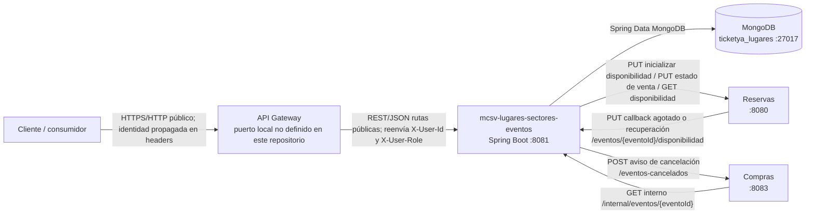
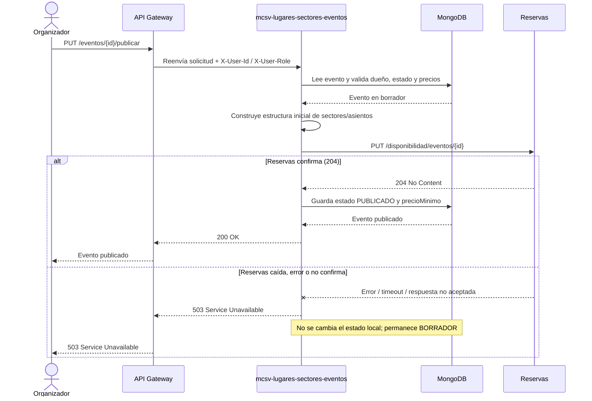
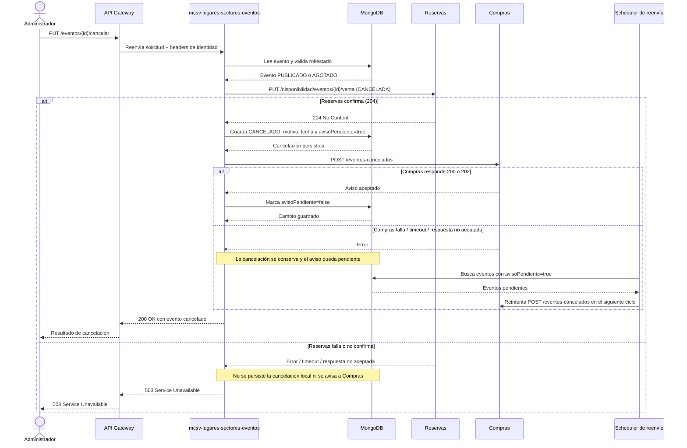
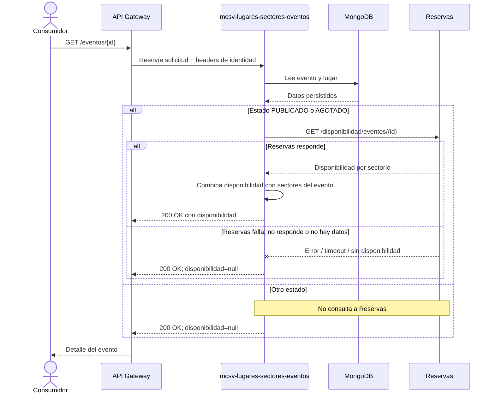

# Diseño de mcsv-lugares-sectores-eventos

## Responsabilidades y límites

Este microservicio administra:

- Lugares físicos y sus sectores, numerados o no numerados.
- Eventos asociados a un lugar, incluidos los sectores del evento copiados del lugar.
- Precios por sector y el límite de entradas por cliente.
- El ciclo de vida del evento: borrador, publicación, suspensión/reactivación de venta, cancelación, agotamiento y finalización.
- Búsqueda paginada y ordenada de eventos publicados o agotados, y consulta de detalle.

No es responsable de administrar inventario/disponibilidad ni reservas, procesar compras o devoluciones, ni autenticar usuarios. La disponibilidad se consulta en Reservas y la disponibilidad agotada se refleja localmente a partir de su callback. Compras consulta la información interna del evento y recibe avisos de cancelación. La identidad y el rol llegan en headers; el servicio aplica autorización por rol/propiedad, pero no valida credenciales ni tokens.

La API pública ofrece operaciones de lugares/sectores y de creación, configuración, publicación, administración, búsqueda y detalle de eventos. Los roles requeridos y el resumen de rutas están en el [README](../README.md#endpoints). La especificación interactiva está en [Swagger UI](http://localhost:8081/swagger-ui/index.html) cuando el servicio local está iniciado. El callback de Reservas y la consulta de Compras son rutas internas y no forman parte de la API publicada por el Gateway.

## Componentes e integración local

Los puertos locales de la aplicación, MongoDB, Reservas y Compras corresponden a `application.yml` y `docker-compose.yml`. El puerto del Gateway no está configurado ni implementado en este repositorio. La comunicación entre microservicios es directa, por HTTP/REST y sin autenticación entre servicios en esta Entrega.

## Secuencias del ciclo de vida y consulta

### Publicar un evento

Para sectores numerados, la solicitud a Reservas incluye los pares `(fila, numero)` derivados de las dimensiones del sector. Un reintento puede volver a inicializar con el mismo contenido; el contrato espera que esa repetición sea idempotente.

### Cancelar un evento

El aviso se intenta inmediatamente después de guardar la cancelación. Su fallo no revierte la cancelación ni cambia la respuesta exitosa de la operación; el scheduler busca los avisos pendientes y los reenvía con el intervalo configurado (60 segundos por defecto).

### Consultar el detalle y su disponibilidad

## Decisiones de diseño

| Decisión | Justificación y evidencia |
|---|---|
| MongoDB desde la Entrega 1 | Según la consigna indicada para este trabajo, la tabla de la Entrega 1 pide una base relacional. La implementación adoptó MongoDB desde esta entrega para evitar migrar datos y cambiar contratos en la Entrega 2. El código confirma MongoDB (`spring-boot-starter-data-mongodb`, colecciones `lugares` y `eventos` y Compose con Mongo), pero el texto de la consigna no está incluido en `openspec/specs` ni en este repositorio; el motivo de anticipar Mongo se documenta como la decisión del proyecto. |
| Confirmar primero en Reservas antes de cambiar el estado local | Evita publicar, suspender, reactivar, cancelar o finalizar localmente si Reservas no confirma la operación correspondiente. En publicación, un fallo remoto devuelve `503` y conserva `BORRADOR`; en cancelación, el fallo evita tanto el cambio local como el aviso a Compras. La secuencia está implementada en `EventoLifecycleService`. |
| Aviso a Compras de mejor esfuerzo, persistido y reenviado | Primero persiste la cancelación y marca `avisoCancelacionPendiente`; después intenta notificar a Compras. Un fallo no revierte el estado local. El scheduler busca los pendientes y reintenta, y al recibir aceptación se borra la marca. Esto evita perder el aviso al reiniciar el proceso. |
| Control optimista de concurrencia por versión | `Lugar` y `Evento` declaran `@Version`. Las escrituras concurrentes con una versión obsoleta no pisan silenciosamente el documento; se traducen a conflicto de actualización. |
| Roles en headers, sin autenticación local | El servicio autoriza usando `X-User-Id` y `X-User-Role`, pero no implementa autenticación ni validación JWT. Según la consigna indicada para el proyecto, JWT corresponde a la Entrega 2. Esa asignación de entrega no aparece en `openspec/specs`; en el código actual solo se verifica el uso de headers y la ausencia de una configuración de seguridad/JWT. |
| Comunicación directa entre servicios, fuera del Gateway y sin autenticación entre servicios | Las llamadas REST a Reservas y Compras y las rutas internas se dirigen directamente a los servicios correspondientes. El contrato del Gateway excluye el callback de disponibilidad, la consulta interna de Compras y las llamadas salientes. Esta es la configuración documentada para la Entrega 1; los clientes HTTP no propagan credenciales de servicio. |
| Copiar datos entre colecciones/servicios cuando se necesita una instantánea | Al crear un evento se copian la ciudad y los datos de sectores del lugar; los precios se asignan al evento. Al publicar se envían a Reservas las dimensiones/capacidad y los asientos derivados. Compras recibe una respuesta interna con los nombres y precios actuales del evento y sector. La copia de ciudad y sectores está verificada en `EventoService`; las persistencias de Reservas y Compras quedan fuera del código de este repositorio. Ver también [modelo de datos](./modelo-de-datos.md). |

## Limitaciones conocidas

- El reenvío de avisos de cancelación usa un intervalo fijo (60 s por defecto), sin backoff ni límite de intentos.
- Con varias instancias de este servicio, más de una puede leer y enviar el mismo aviso pendiente antes de que se marque como entregado; puede haber avisos duplicados. Compras debe tolerar duplicados.
- No hay un endpoint para solicitar manualmente el reenvío de un aviso ya entregado. El scheduler solo selecciona eventos cuyo `avisoCancelacionPendiente` sigue en `true`.

## Trazabilidad de OpenSpec a pruebas

Las capacidades de la tabla son los requisitos de `openspec/specs/lugares-y-sectores/spec.md` y `openspec/specs/eventos/spec.md`. La tabla identifica las clases de prueba que cubren cada capacidad, no afirma que cada escenario de la spec corresponda a un único test.

| Spec | Capacidad | Clases de prueba |
|---|---|---|
| `lugares-y-sectores` | Registrar lugares con datos válidos | `LugarControllerTest`, `LugarApiEndToEndTest`, `LugarServiceTest` |
| `lugares-y-sectores` | Registrar sectores numerados | `LugarControllerTest`, `LugarApiEndToEndTest`, `LugarServiceTest`, `AsientoNumeradoTest` |
| `lugares-y-sectores` | Registrar sectores no numerados | `LugarControllerTest`, `LugarApiEndToEndTest`, `LugarServiceTest` |
| `lugares-y-sectores` | Consultar lugares y sectores | `LugarControllerTest`, `LugarApiEndToEndTest`, `DevSampleDataIntegrationTest` |
| `lugares-y-sectores` | Normalizar rol administrativo de lugares/sectores | `LugarControllerTest` |
| `lugares-y-sectores` | Responder errores inesperados de forma segura | `LugarControllerTest`, `LugarApiEndToEndTest` |
| `eventos` | Crear eventos en borrador | `EventoServiceTest`, `EventoControllerTest` |
| `eventos` | Definir límite de entradas por cliente | `EventoServiceTest`, `EventoControllerTest`, `EventoLifecycleServiceTest` |
| `eventos` | Definir precios por sector en borrador | `EventoServiceTest`, `EventoControllerTest` |
| `eventos` | Publicar eventos con disponibilidad inicializada | `EventoLifecycleServiceTest`, `EventoControllerTest`, `HttpReservasClientTest` |
| `eventos` | Administrar suspensión, reactivación y cancelación | `EventoLifecycleServiceTest`, `ComprasCancellationFlowTest`, `HttpComprasClientTest` |
| `eventos` | Reflejar automáticamente disponibilidad y finalización | `EventoLifecycleServiceTest`, `EventoServiceTest`, `EventoControllerTest` |
| `eventos` | Ofrecer a Compras una consulta interna del evento | `EventoControllerTest` |
| `eventos` | Mantener estados y formato de errores acordados | `EventoServiceTest`, `EventoControllerTest`, `OpenApiDocumentationTest` |
| `eventos` | Compartir identidad de asiento con Reservas | `AsientoNumeradoTest`, `EventoLifecycleServiceTest`, `HttpReservasClientTest` |
| `eventos` | Buscar eventos publicados y agotados | `EventoConsultaServiceTest`, `EventoConsultaControllerTest`, `EventoRepositoryMongoTest` |
| `eventos` | Ordenar y paginar la búsqueda de eventos | `EventoConsultaServiceTest`, `EventoConsultaControllerTest`, `EventoRepositoryMongoTest` |
| `eventos` | Consultar el detalle público de un evento | `EventoConsultaServiceTest`, `EventoConsultaControllerTest` |
| `eventos` | Incluir disponibilidad de Reservas en el detalle público | `EventoDetalleDisponibilidadIntegrationTest`, `HttpReservasClientTest`, `EventoControllerTest` |
| `eventos` | Normalizar rol administrativo del ciclo de vida | `EventoLifecycleServiceTest`, `EventoControllerTest`, `EventoConsultaServiceTest` |
| `eventos` | Responder errores inesperados de forma segura | `EventoControllerTest`, `EventoConsultaControllerTest`, `OpenApiDocumentationTest` |

## Referencias

- Especificaciones: [`openspec/specs/lugares-y-sectores/spec.md`](../../openspec/specs/lugares-y-sectores/spec.md) y [`openspec/specs/eventos/spec.md`](../../openspec/specs/eventos/spec.md).
- Contrato de exposición del API: [`docs/api-gateway-contract.md`](./api-gateway-contract.md).
- Modelo de persistencia: [`docs/modelo-de-datos.md`](./modelo-de-datos.md).
- Configuración de puertos y URL de servicios: `src/main/resources/application.yml` y `docker-compose.yml`.
