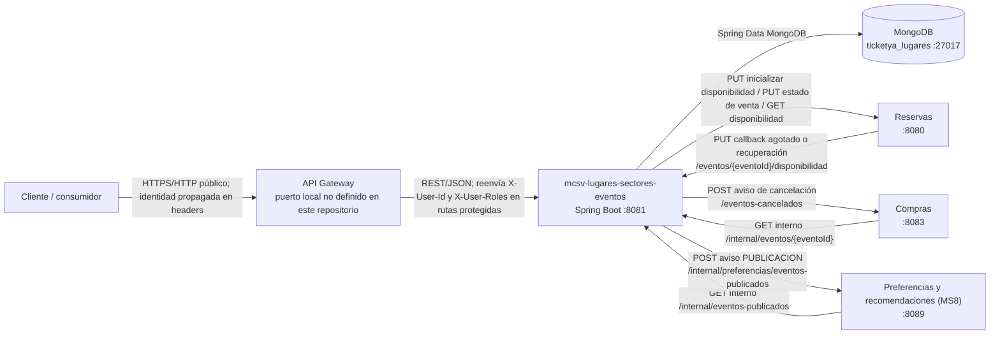
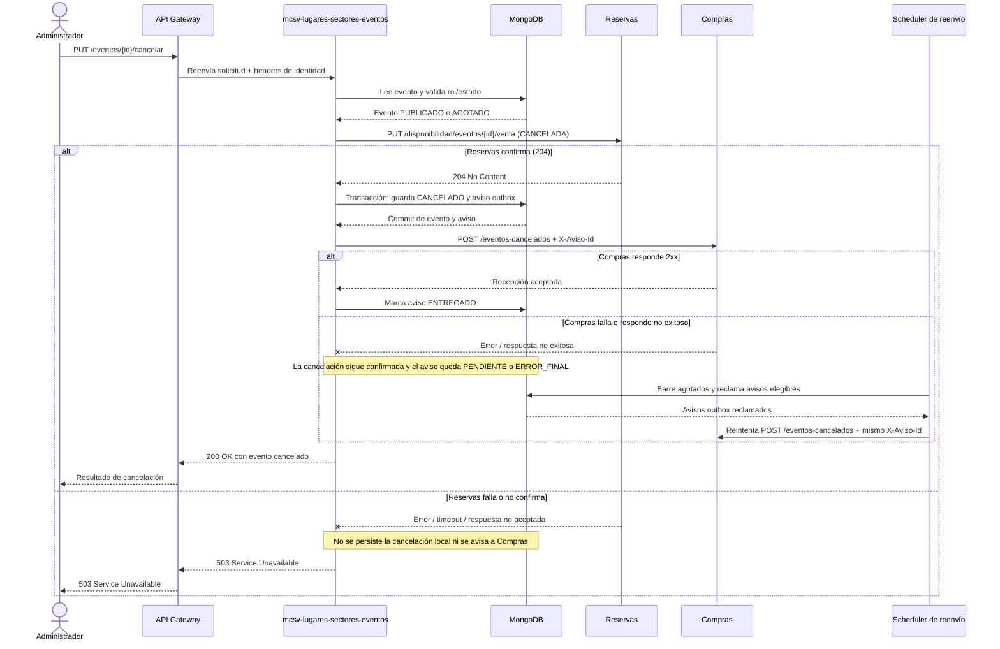

# Diseño de mcsv-lugares-sectores-eventos

## Responsabilidades y límites

Este microservicio administra:

- Lugares físicos y sus sectores, numerados o no numerados.
- Eventos asociados a un lugar, incluidos los sectores del evento copiados del lugar.
- Precios por sector y el límite de entradas por cliente.
- El ciclo de vida del evento: borrador, publicación, suspensión/reactivación de venta, cancelación, agotamiento y finalización.
- Búsqueda paginada y ordenada de eventos publicados o agotados, y consulta de detalle.

No es responsable de administrar inventario/disponibilidad ni reservas, procesar compras o devoluciones, ni autenticar usuarios. La disponibilidad se consulta en Reservas y la disponibilidad agotada se refleja localmente a partir de su callback. Compras consulta el detalle interno del evento y recibe avisos de cancelación; Preferencias y recomendaciones (MS8) consulta los eventos publicados y recibe avisos `PUBLICACION`. En las rutas protegidas, el Gateway valida el JWT y propaga `X-User-Id` con el claim `sub` y `X-User-Roles` como lista separada por comas; el servicio aplica autorización por rol/propiedad, pero no valida credenciales ni tokens. La búsqueda y el detalle de eventos publicados o agotados no requieren token.

La API pública ofrece operaciones de lugares/sectores y de creación, configuración, publicación, administración, búsqueda y detalle de eventos. Los roles requeridos y el resumen de rutas están en el [README](../README.md#endpoints). La especificación interactiva está en [Swagger UI](http://localhost:8081/swagger-ui/index.html) cuando el servicio local está iniciado. El callback de Reservas y las consultas de Compras y Preferencias son rutas internas y no forman parte de la API publicada por el Gateway.

## Componentes e integración local



Los puertos locales de la aplicación, MongoDB, Reservas, Compras y Preferencias corresponden a `application.yml` y `docker-compose.yml`. El puerto del Gateway no está configurado ni implementado en este repositorio. La comunicación entre microservicios es directa, por HTTP/REST y sin autenticación entre servicios en esta Entrega.

## Secuencias del ciclo de vida y consulta

### Publicar un evento

```mermaid
sequenceDiagram
    actor Organizador
    participant GW as API Gateway
    participant GL as mcsv-lugares-sectores-eventos
    participant DB as MongoDB
    participant R as Reservas
    participant P as Preferencias (MS8)

    Organizador->>GW: PUT /eventos/{id}/publicar
    GW->>GL: Reenvía solicitud + X-User-Id / X-User-Roles
    GL->>DB: Lee evento y valida dueño, estado y precios
    DB-->>GL: Evento en borrador
    GL->>GL: Construye estructura inicial de sectores/asientos
    GL->>R: PUT /disponibilidad/eventos/{id}
    alt Reservas confirma (204)
        R-->>GL: 204 No Content
        GL->>DB: Transacción: guarda PUBLICADO y aviso PUBLICACION
        DB-->>GL: Commit de evento y aviso
        GL->>P: POST /internal/preferencias/eventos-publicados + X-Aviso-Id
        alt Preferencias responde 2xx
            P-->>GL: Aviso aceptado
            GL->>DB: Marca aviso ENTREGADO
        else Preferencias falla o no responde
            P--xGL: Error / respuesta no exitosa
            Note over GL,DB: Publicación confirmada; el aviso queda PENDIENTE o ERROR_FINAL
            Note over GL,P: El dispatcher reintenta de forma asíncrona
        end
        GL-->>GW: 200 OK
        GW-->>Organizador: Evento publicado
    else Reservas caída, error o no confirma
        R--xGL: Error / timeout / respuesta no aceptada
        GL-->>GW: 503 Service Unavailable
        Note over GL,DB: No se cambia el estado local#59; permanece BORRADOR
        GW-->>Organizador: 503 Service Unavailable
    end
```

Para sectores numerados, la solicitud a Reservas incluye los pares `(fila, numero)` derivados de las dimensiones del sector. Un reintento puede volver a inicializar con el mismo contenido; el contrato espera que esa repetición sea idempotente.

### Consultar eventos para Preferencias

MS8 consulta directamente `GET /internal/eventos-publicados`, sin headers de usuario y fuera del Gateway. La respuesta paginada contiene solo eventos `publicado` o `agotado` y los campos `eventoId`, `nombre`, `tipo`, `participantes`, `ciudad`, `fechaHora` UTC y `estado`. `page` inicia en cero; `size` usa 100 por defecto, con máximo 200. La consulta ordena por fecha e ID del evento para conservar el orden entre páginas. Los parámetros inválidos responden `400`.

### Cancelar un evento



El aviso se guarda en la misma transacción MongoDB que la cancelación y se intenta inmediatamente después del commit. Su fallo no revierte la cancelación ni cambia la respuesta exitosa. El scheduler general primero marca como `ERROR_FINAL` los avisos `PENDIENTE` con el máximo de intentos y los `PROCESANDO` cuyo lease venció tras alcanzar el máximo; luego reclama avisos elegibles y reintenta hasta 100 por pasada. El intervalo se configura con `OUTBOX_DISPATCHER_INTERVAL` (60 segundos por defecto).

### Consultar el detalle y su disponibilidad

```mermaid
sequenceDiagram
    actor Consumidor
    participant GW as API Gateway
    participant GL as mcsv-lugares-sectores-eventos
    participant DB as MongoDB
    participant R as Reservas

    Consumidor->>GW: GET /eventos/{id} (sin token para publicado/agotado)
    GW->>GL: Reenvía solicitud; headers opcionales para borradores
    GL->>DB: Lee evento y lugar
    DB-->>GL: Datos persistidos
    alt Estado PUBLICADO o AGOTADO
        GL->>R: GET /disponibilidad/eventos/{id}
        alt Reservas responde
            R-->>GL: Disponibilidad por sectorId
            GL->>GL: Combina disponibilidad con sectores del evento
            GL-->>GW: 200 OK con disponibilidad
        else Reservas falla, no responde o no hay datos
            R--xGL: Error / timeout / sin disponibilidad
            GL-->>GW: 200 OK#59; disponibilidad=null
        end
    else Borrador
        Note over GL,R: Requiere X-User-Id y ORGANIZADOR titular o ADMIN
        GL-->>GW: 200 OK solo para propietario autorizado; de lo contrario 401/404
    else Estado distinto de PUBLICADO/AGOTADO
        Note over GL,R: El borrador exige titular ORGANIZADOR o ADMIN; cancelado/finalizado son visibles sin disponibilidad
        GL-->>GW: 200 OK para borrador autorizado, cancelado o finalizado; 401/404 si el borrador no está autorizado
    end
    GW-->>Consumidor: Detalle del evento
```

## Decisiones de diseño

| Decisión | Justificación y evidencia |
|---|---|
| MongoDB desde la Entrega 1 | Según la consigna indicada para este trabajo, la tabla de la Entrega 1 pide una base relacional. La implementación adoptó MongoDB desde esta entrega para evitar migrar datos y cambiar contratos en la Entrega 2. El código confirma MongoDB (`spring-boot-starter-data-mongodb`, colecciones `lugares` y `eventos` y Compose con Mongo), pero el texto de la consigna no está incluido en `openspec/specs` ni en este repositorio; el motivo de anticipar Mongo se documenta como la decisión del proyecto. |
| Confirmar primero en Reservas antes de cambiar el estado local | Evita publicar, suspender, reactivar, cancelar o finalizar localmente si Reservas no confirma la operación correspondiente. En publicación, un fallo remoto devuelve `503` y conserva `BORRADOR`; en cancelación, el fallo evita tanto el cambio local como el aviso a Compras. La secuencia está implementada en `EventoLifecycleService`. |
| Avisos a Compras y Preferencias mediante outbox transaccional | La cancelación guarda evento y aviso `CANCELACION` con ID `cancelacion-{eventoId}`; la publicación guarda evento y aviso `PUBLICACION` con ID `publicacion-{eventoId}`. Ambos avisos se insertan en `outbox` con el cambio local en una transacción MongoDB y se entregan después del commit mediante el dispatcher general y `X-Aviso-Id`. Cualquier `2xx` marca `ENTREGADO`, y los errores temporales se reintentan. La entrega inmediata de publicación es síncrona y el dispatcher reintenta de forma asíncrona si falla. El flag `avisoCancelacionPendiente` fue retirado; un backfill transitorio migra documentos legacy al iniciar. |
| Índices de outbox | `_id_` único garantiza que no se repita el ID del aviso. `idx_outbox_estado_proximo_intento` (`estado`, `proximoIntento`, `intentos`) selecciona pendientes vencidos; `idx_outbox_estado_lease` (`estado`, `leaseHasta`, `intentos`) recupera leases vencidos y apoya el barrido de intentos agotados. |
| Control optimista de concurrencia por versión | `Lugar` y `Evento` declaran `@Version`. Las escrituras concurrentes con una versión obsoleta no pisan silenciosamente el documento; se traducen a conflicto de actualización. |
| Identidad propagada por el Gateway, sin autenticación local | El Gateway valida el JWT y envía el claim `sub` como `X-User-Id` y la lista de roles como `X-User-Roles`. El microservicio evalúa todos los roles sin precedencia arbitraria y aplica además la titularidad; no valida el token directamente. |
| Comunicación directa entre servicios, fuera del Gateway y sin autenticación entre servicios | Las llamadas REST a Reservas, Compras y Preferencias y las rutas internas se dirigen directamente a los servicios correspondientes. El contrato del Gateway excluye el callback de disponibilidad, las consultas internas de Compras y Preferencias y las llamadas salientes. Esta es la configuración documentada para la Entrega 1; los clientes HTTP no propagan credenciales de servicio. |
| Copiar datos entre colecciones/servicios cuando se necesita una instantánea | Al crear un evento se copian la ciudad y los datos de sectores del lugar; los precios se asignan al evento. Al publicar se envían a Reservas las dimensiones/capacidad y los asientos derivados. Compras recibe una respuesta interna con los nombres y precios actuales del evento y sector. La copia de ciudad y sectores está verificada en `EventoService`; las persistencias de Reservas y Compras quedan fuera del código de este repositorio. Ver también [modelo de datos](./modelo-de-datos.md). |

## Limitaciones conocidas

- `ERROR_FINAL` requiere revisión directa en MongoDB; no existe un endpoint para reprocesar manualmente avisos.
- El dispatcher limita cada pasada a 100 avisos. Un lease vencido permite recuperar un reclamo; el destino puede recibir una reentrega con el mismo `X-Aviso-Id` y debe tolerar duplicados.

## Trazabilidad de OpenSpec a pruebas

Las capacidades de la tabla son los requisitos de `openspec/specs/lugares-y-sectores/spec.md` y `openspec/specs/eventos/spec.md`. La tabla identifica las clases de prueba que cubren cada capacidad, no afirma que cada escenario de la spec corresponda a un único test.

| Spec | Capacidad | Clases de prueba |
|---|---|---|
| `lugares-y-sectores` | Registrar lugares con datos válidos | `LugarControllerTest`, `LugarApiEndToEndTest`, `LugarServiceTest` |
| `lugares-y-sectores` | Registrar sectores numerados | `LugarControllerTest`, `LugarApiEndToEndTest`, `LugarServiceTest`, `AsientoNumeradoTest` |
| `lugares-y-sectores` | Registrar sectores no numerados | `LugarControllerTest`, `LugarApiEndToEndTest`, `LugarServiceTest` |
| `lugares-y-sectores` | Consultar lugares y sectores | `LugarControllerTest`, `LugarApiEndToEndTest`, `DevSampleDataIntegrationTest` |
| `lugares-y-sectores` | Normalizar rol administrativo de lugares/sectores | `LugarControllerTest` |
| `lugares-y-sectores` | Responder errores inesperados de forma segura | `LugarControllerTest`, `LugarApiEndToEndTest` |
| `eventos` | Crear eventos en borrador | `EventoServiceTest`, `EventoControllerTest` |
| `eventos` | Definir límite de entradas por cliente | `EventoServiceTest`, `EventoControllerTest`, `EventoLifecycleServiceTest` |
| `eventos` | Definir precios por sector en borrador | `EventoServiceTest`, `EventoControllerTest` |
| `eventos` | Publicar eventos con disponibilidad inicializada | `EventoLifecycleServiceTest`, `EventoControllerTest`, `HttpReservasClientTest` |
| `eventos` | Administrar suspensión, reactivación y cancelación | `EventoLifecycleServiceTest`, `ComprasCancellationFlowTest`, `EventoCancelacionOutboxIntegrationTest` |
| `eventos` | Persistir y entregar avisos outbox | `OutboxAvisoRepositoryMongoTest`, `OutboxDispatcherTest`, `OutboxSchedulerTest`, `RestClientOutboxHttpClientTest`, `EventoCancelacionOutboxIntegrationTest`, `EventoPublicacionOutboxIntegrationTest` |
| `eventos` | Reflejar automáticamente disponibilidad y finalización | `EventoLifecycleServiceTest`, `EventoServiceTest`, `EventoControllerTest` |
| `eventos` | Ofrecer a Compras una consulta interna del evento | `EventoControllerTest` |
| `eventos` | Ofrecer a Preferencias una consulta interna de eventos publicados | `EventoControllerTest`, `EventoConsultaServiceTest`, `EventoRepositoryMongoTest` |
| `eventos` | Mantener estados y formato de errores acordados | `EventoServiceTest`, `EventoControllerTest`, `OpenApiDocumentationTest` |
| `eventos` | Compartir identidad de asiento con Reservas | `AsientoNumeradoTest`, `EventoLifecycleServiceTest`, `HttpReservasClientTest` |
| `eventos` | Buscar eventos publicados y agotados | `EventoConsultaServiceTest`, `EventoConsultaControllerTest`, `EventoRepositoryMongoTest` |
| `eventos` | Ordenar y paginar la búsqueda de eventos | `EventoConsultaServiceTest`, `EventoConsultaControllerTest`, `EventoRepositoryMongoTest` |
| `eventos` | Consultar el detalle público de un evento | `EventoConsultaServiceTest`, `EventoConsultaControllerTest` |
| `eventos` | Incluir disponibilidad de Reservas en el detalle público | `EventoDetalleDisponibilidadIntegrationTest`, `HttpReservasClientTest`, `EventoControllerTest` |
| `eventos` | Normalizar rol administrativo del ciclo de vida | `EventoLifecycleServiceTest`, `EventoControllerTest`, `EventoConsultaServiceTest` |
| `eventos` | Responder errores inesperados de forma segura | `EventoControllerTest`, `EventoConsultaControllerTest`, `OpenApiDocumentationTest` |

## Referencias

- Especificaciones: [`openspec/specs/lugares-y-sectores/spec.md`](../../openspec/specs/lugares-y-sectores/spec.md) y [`openspec/specs/eventos/spec.md`](../../openspec/specs/eventos/spec.md).
- Contrato de exposición del API: [`docs/api-gateway-contract.md`](./api-gateway-contract.md).
- Modelo de persistencia: [`docs/modelo-de-datos.md`](./modelo-de-datos.md).
- Configuración de puertos y URL de servicios: `src/main/resources/application.yml` y `docker-compose.yml`.
