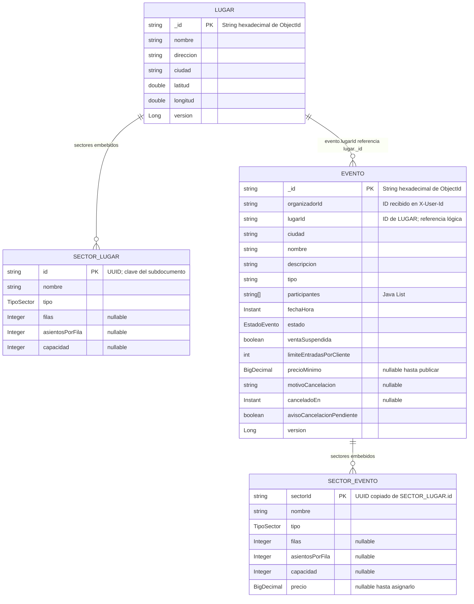

# Modelo de datos

Este servicio persiste dos colecciones MongoDB propias: `lugares` y `eventos`. Los sectores son subdocumentos embebidos; no tienen colección propia. En el diagrama, `PK` indica la clave del documento o la clave estable del subdocumento, no una restricción de clave foránea de MongoDB.

`LUGAR._id` y `EVENTO._id` son propiedades Java `String` marcadas con `@Id`; el código las crea como hexadecimal de `ObjectId`. `SECTOR_LUGAR.id` se genera como UUID en formato `String`. Al crear un evento se copia ese valor a `SECTOR_EVENTO.sectorId`. `TipoSector` admite `NUMERADO` y `NO_NUMERADO`; `EstadoEvento` admite `BORRADOR`, `PUBLICADO`, `AGOTADO`, `CANCELADO` y `FINALIZADO` (la API los serializa en minúsculas).

La relación `evento.lugarId` es una referencia por ID entre documentos de este mismo servicio. Se resuelve mediante `LugarRepository`; no hay una clave foránea ni una relación gestionada por MongoDB. Las listas de sectores, en cambio, forman parte de cada documento.

## Relaciones con otros servicios

En la Entrega 1, este servicio se comunica directamente por REST/JSON. Las referencias entre servicios son IDs: no hay claves foráneas ni lecturas directas a bases de datos ajenas.

| Dirección | Dato | Comportamiento verificado en este repositorio |
|---|---|---|
| Entrada a este servicio | `organizadorId` | Se toma del header `X-User-Id` y se guarda en el evento. En esta Entrega 1 no hay integración con un servicio de usuarios en este código. |
| Este servicio → Reservas | `eventoId`, `sectorId`, `fila`, `numero` | Al publicar, se envía el ID del evento en la ruta y el ID de cada sector en el body. Para sectores numerados se generan y envían los pares de coordenadas de asiento; Reservas recibe esos datos para inicializar disponibilidad. |
| Compras → este servicio | `eventoId` | Compras consulta `GET /internal/eventos/{eventoId}`. La respuesta incluye el ID del evento y cada `sectorId`, además del nombre del evento, nombre del sector y precio. |
| Reservas → este servicio | `eventoId` y `agotado` | Reservas notifica cambios de disponibilidad mediante `PUT /eventos/{eventoId}/disponibilidad`; el callback actualiza el estado local entre `PUBLICADO` y `AGOTADO`. |

**Límite de verificación:** este repositorio no contiene el código de persistencia ni de compra de Reservas o Compras. El cliente de este servicio y el stub de Postman permiten verificar los datos enviados a Reservas; el endpoint interno permite verificar los datos que este servicio entrega a Compras. No permiten confirmar, por sí solos, qué campos guardan las implementaciones reales de esos otros servicios. Por eso, la copia de `eventoId`, `sectorId` y `(fila, numero)` en Reservas, y la copia de nombre/precio en Compras, no se afirman aquí como persistencias externas verificadas.

## Entidades y datos solapados entre bases

| Dato compartido | Fuente de verdad y copia |
|---|---|
| `eventos.ciudad` | El lugar aporta la ciudad al crear el evento. `EventoService` guarda una copia junto con `lugarId`; no vuelve a derivarla del lugar al buscar eventos. La estructura de sectores también se copia del lugar al crear el evento. Luego, el evento conserva su propia instantánea; cada precio de sector se asigna al evento. |
| Sectores y asientos al publicar | La estructura inicial se toma de `eventos.sectores`. Este servicio envía a Reservas `sectorId`, tipo y capacidad. Para sectores numerados calcula `capacidadTotal = filas × asientosPorFila` y genera los pares `(fila, numero)`; para los no numerados envía la capacidad configurada y una lista de asientos vacía. La persistencia de esa copia en Reservas no se puede comprobar en este repositorio. |
| Nombre del evento, nombre del sector y precio al comprar | La respuesta interna disponible para Compras expone `eventoId`, nombre del evento y, por sector, `sectorId`, nombre y precio. El nombre/precio vigente aquí se mantiene en `eventos` y sus sectores embebidos. Que Compras copie estos valores al registrar una compra no es verificable sin el código de Compras. |
| Estado `AGOTADO` | La disponibilidad de Reservas es la fuente operativa; Reservas notifica el resultado con el callback `agotado`. Este servicio guarda el estado del evento como una proyección local y no recalcula la disponibilidad. El origen y el efecto local del callback están en el contrato y código de este servicio; el almacenamiento interno de Reservas queda fuera del repositorio. |

## Índices

Además de los índices automáticos `_id_` de MongoDB, el código declara los siguientes índices:

| Colección | Índice | Campos | Uso |
|---|---|---|---|
| `lugares` | `idx_lugares_ciudad_nombre` | `ciudad` ascendente, `nombre` ascendente | Índice compuesto para filtros/orden por ciudad y nombre. Las operaciones actuales de lugares no aplican esos filtros. |
| `lugares` | `idx_lugares_nombre` | `nombre` ascendente | Índice disponible para búsquedas por nombre; las operaciones actuales de lugares no filtran por nombre. |
| `eventos` | `idx_eventos_estado_fecha` | `estado`, `fechaHora` ascendentes | Filtrar por estado y ordenar/limitar por fecha. |
| `eventos` | `idx_eventos_estado_ciudad_fecha` | `estado`, `ciudad`, `fechaHora` ascendentes | Búsqueda de eventos por estado y ciudad, ordenada por fecha. |
| `eventos` | `idx_eventos_organizador_estado` | `organizadorId`, `estado` ascendentes | Consultar eventos de un organizador por estado. |
| `eventos` | `organizadorId` (nombre generado) | `organizadorId` ascendente | Filtro por organizador. |
| `eventos` | `idx_eventos_tipo` | `tipo` ascendente | Filtro por tipo de evento. |
| `eventos` | `idx_eventos_participantes` | `participantes` ascendente (multikey) | Filtro por participante. |
| `eventos` | `Evento_TextIndex` | `nombre`, `descripcion`, `participantes` | Búsqueda de texto y orden por relevancia. |
| `eventos` | `avisoCancelacionPendiente` (nombre generado) | `avisoCancelacionPendiente` ascendente | Encontrar documentos con avisos de cancelación pendientes para reintentar su entrega. |

El orden por `precioMinimo` se realiza en las consultas, pero no hay un índice de precio declarado en el modelo. Los índices compuestos ayudan a los filtros/órdenes indicados, aunque el plan elegido depende de la consulta y de MongoDB.

## Decisiones del modelo

| Decisión | Justificación |
|---|---|
| Embebir los sectores en lugares y eventos | El código los administra como parte de su documento padre y los carga juntos. En el evento se necesita una instantánea del sector del lugar y un precio propio, por lo que un subdocumento permite conservar ambos sin una colección separada. |
| No persistir cada asiento | Para un sector numerado, las coordenadas se derivan de `filas` y `asientosPorFila`; se enumeran al publicar. Así no se guardan filas de asientos estáticos en este servicio. La ocupación/disponibilidad se delega a Reservas. |
| Usar `BigDecimal` y BSON `Decimal128` para precios | `BigDecimal` representa decimales monetarios sin la aproximación binaria de `double`. `MongoDecimalConfiguration` convierte explícitamente entre `BigDecimal` y `Decimal128` al escribir y leer. |
| Copiar la ciudad al evento | `ciudad` participa como filtro de búsqueda de eventos. Guardarla en el evento permite consultar y filtrar eventos sin cargar el lugar por cada resultado; es una copia tomada al crear el evento, no una sincronización automática. |

## Evidencia en código

- Documentos y subdocumentos: `domain/Lugar.java`, `domain/Sector.java`, `domain/Evento.java`, `domain/EventoSector.java`.
- Copia de lugar a evento y de ciudad/sectores: `service/EventoService.java`.
- Generación de sectores de asiento para Reservas y callback: `service/EventoLifecycleService.java`, `api/EventoController.java`.
- Índices MongoDB: anotaciones de `domain/Lugar.java` y `domain/Evento.java`; prueba de índices de evento en `EventoRepositoryMongoTest`.
- Contratos de integración: `api/EventoInternoResponse.java`, `reservas/dto/InicializarDisponibilidadRequest.java` y `reservas/dto/SectorDisponibilidadRequest.java`.
