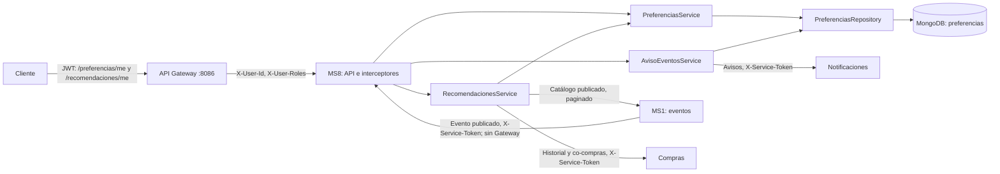
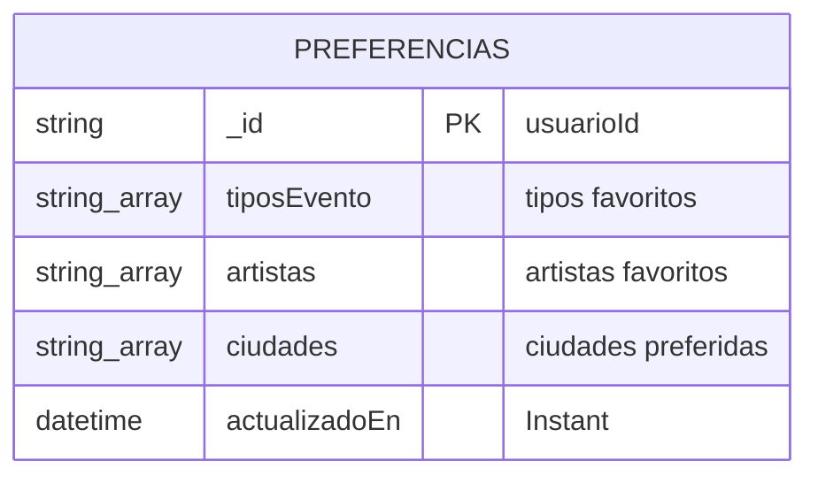

# Diseño de MS8: preferencias y recomendaciones

## Módulos e integraciones

El Gateway valida el JWT y autoriza el rol `CLIENTE`. Las llamadas
`/internal/**` son entre servicios y no pasan por el Gateway. MS8 confía en
los headers de identidad inyectados por el Gateway, no valida JWT; el acceso
directo debe limitarse a redes confiables. Si Compras falla se usan solo las
preferencias; si falla el catálogo de MS1, la consulta responde `503`.

## Modelo de datos MongoDB

La única clase `@Document` de MS8 es `Preferencia`, en la colección
`preferencias`. Se almacena un documento por usuario; las listas están
embebidas y no son colecciones independientes. El ID del usuario referencia
externamente a MS6, sin relación ni clave foránea MongoDB.

MS8 no persiste eventos, compras ni avisos enviados: los consulta o entrega a
los servicios responsables.
