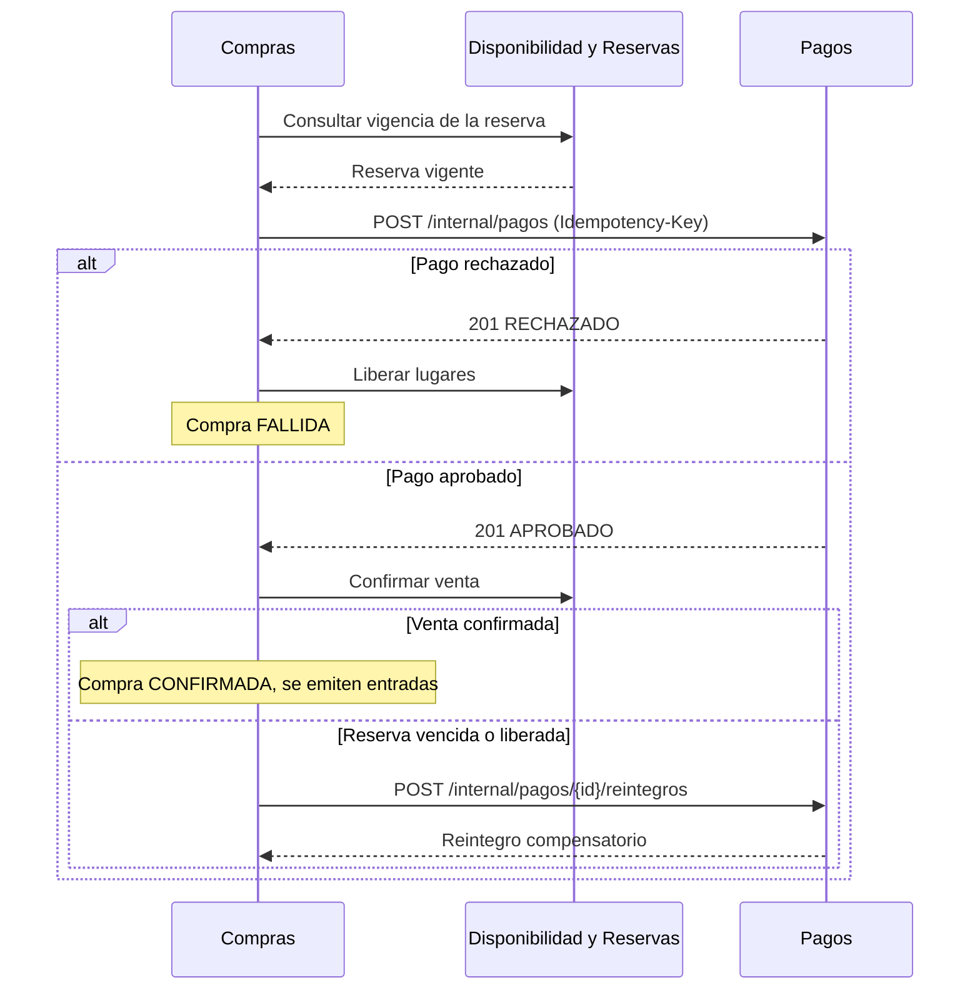
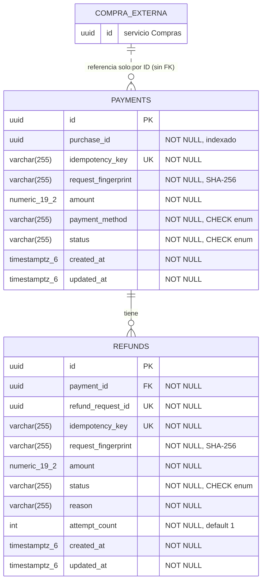

# Diseño del microservicio de Gestión de pagos (msvc-pagos)

TicketYa · Arquitectura Web (TUDAI) · Entrega 1

## 1. Propósito y rol en la arquitectura

`msvc-pagos` simula la pasarela de pagos externa: procesa y registra cobros y reintegros asociados a las compras. Es el microservicio 4 de los cinco que componen el sistema.

- **Servicio interno:** lo invoca únicamente el microservicio de Compras y Devoluciones. El API Gateway **no** lo expone, por lo que ningún cliente externo puede crear cobros o reintegros sin pasar por Compras.
- **Sin datos sensibles:** no almacena datos reales de tarjetas. Solo guarda el medio de pago (`paymentMethod`) como dato de simulación.
- **Base propia:** PostgreSQL, esquema `ticketya_payments`. Ningún otro servicio accede a sus tablas; la integración es solo por API REST e identificadores.
- **Stack:** Spring Boot 3.4.5, Java 17, Spring Data JPA, PostgreSQL, springdoc-openapi (Swagger UI).

### Participación en el flujo de compra



Pagos también procesa los reintegros de devoluciones aprobadas y de eventos cancelados, siempre a pedido de Compras.

## 2. Endpoints

Todos son internos. No hay prefijo `/api/v1`; se sigue la convención `/internal` del resto de los servicios.

| Método | Ruta | Descripción | Header obligatorio |
|---|---|---|---|
| POST | `/internal/pagos` | Crea un pago | `Idempotency-Key` |
| GET | `/internal/pagos/{paymentId}` | Consulta un pago | — |
| GET | `/internal/pagos/compra/{purchaseId}` | Lista los pagos de una compra (lista vacía con 200 si no hay) | — |
| POST | `/internal/pagos/{paymentId}/reintegros` | Crea un reintegro total o parcial | `Idempotency-Key` |
| GET | `/internal/reintegros/{refundId}` | Consulta un reintegro | — |
| POST | `/internal/reintegros/{refundId}/reintentar` | Reintenta un reintegro `FALLIDO` | No lleva clave |

La documentación OpenAPI se genera desde los controllers y está disponible en `/swagger-ui/index.html` (definición en `/v3/api-docs`).

### Códigos de respuesta

| HTTP | Uso |
|---|---|
| 200 | Consulta, repetición idempotente o reintento resuelto |
| 201 | Pago o reintegro nuevo |
| 400 | Solicitud, header o validación inválida (incluye UUID mal formado) |
| 404 | Pago o reintegro inexistente |
| 405 | Método no permitido |
| 409 | Conflicto de idempotencia, saldo de reintegros, compra con pago aprobado o reintento no permitido |
| 500 | Error interno genérico, sin exponer detalles de la excepción |

Los errores usan el formato `ApiError`: `{timestamp, status, error, mensaje, campos?}`. `campos` aparece solo en errores de validación (400).

## 3. Modelo de datos

### Diagrama entidad-relación



El diagrama generado por pgAdmin a partir de la base real coincide con este modelo (ver `docs/der-pagos.png`, si se incluye).

### Diccionario de datos

**Tabla `payments`**

| Columna | Tipo | Restricciones |
|---|---|---|
| `id` | UUID | PK |
| `purchase_id` | UUID | NOT NULL. Referencia por ID a una compra de Compras. Índice `idx_payment_purchase_id` |
| `idempotency_key` | VARCHAR(255) | NOT NULL, UNIQUE |
| `request_fingerprint` | VARCHAR(255) | NOT NULL. Huella SHA-256 del payload normalizado |
| `amount` | NUMERIC(19,2) | NOT NULL |
| `payment_method` | VARCHAR(255) | NOT NULL. CHECK: `CREDIT_CARD`, `DEBIT_CARD`, `BANK_TRANSFER`, `DIGITAL_WALLET` |
| `status` | VARCHAR(255) | NOT NULL. CHECK: `EN_PROCESO`, `APROBADO`, `RECHAZADO` |
| `created_at` | TIMESTAMPTZ(6) | NOT NULL, no se actualiza |
| `updated_at` | TIMESTAMPTZ(6) | NOT NULL |

**Tabla `refunds`**

| Columna | Tipo | Restricciones |
|---|---|---|
| `id` | UUID | PK |
| `payment_id` | UUID | NOT NULL. FK → `payments(id)` |
| `refund_request_id` | UUID | NOT NULL, UNIQUE. Lo genera Compras |
| `idempotency_key` | VARCHAR(255) | NOT NULL, UNIQUE |
| `request_fingerprint` | VARCHAR(255) | NOT NULL. Huella SHA-256 del payload normalizado |
| `amount` | NUMERIC(19,2) | NOT NULL |
| `status` | VARCHAR(255) | NOT NULL. CHECK: `PENDIENTE`, `EXITOSO`, `FALLIDO` |
| `reason` | VARCHAR(255) | NOT NULL |
| `attempt_count` | INTEGER | NOT NULL, por defecto 1 |
| `created_at` | TIMESTAMPTZ(6) | NOT NULL, no se actualiza |
| `updated_at` | TIMESTAMPTZ(6) | NOT NULL |

> Los valores `EN_PROCESO` y `PENDIENTE` están permitidos por los CHECK, pero la aplicación no los persiste: cada operación se crea y se resuelve en una única transacción (ver sección 7).

### Índices

| Índice | Definición | Función |
|---|---|---|
| `idx_payment_purchase_id` | `payments(purchase_id)` | Acelera el listado de pagos por compra |
| `uk_payment_approved_purchase` | `UNIQUE payments(purchase_id) WHERE status = 'APROBADO'` | Garantiza como máximo **un pago aprobado por compra**. Es un índice parcial definido en `schema.sql` |
| Unicidad de `idempotency_key` | `payments` y `refunds` | Una sola operación por clave |
| Unicidad de `refund_request_id` | `refunds` | Evita reintegros duplicados para una misma solicitud |

### Relaciones con otros servicios y entidades solapadas

- **Relaciones entre servicios:** la única es `payments.purchase_id`, que apunta a una compra del servicio de Compras **solo por identificador**, sin clave foránea ni acceso a sus tablas. `refund_request_id` también lo origina Compras; Pagos solo lo usa para evitar duplicados.
- **Entidades solapadas:** no se duplican entidades entre bases. El único dato que coincide conceptualmente es el **monto**: Compras guarda el total y el precio unitario por entrada, y Pagos guarda `amount` como registro histórico de lo cobrado. Pagos lo necesita para validar el tope de reintegros sin consultar a Compras.

## 4. Idempotencia

Cada operación de escritura lleva una clave de idempotencia (`Idempotency-Key` para cobros y reintegros; además, `refundRequestId` para reintegros).

1. Al recibir una solicitud, se calcula una **huella SHA-256 del payload normalizado** (`request_fingerprint`).
2. **Misma clave y misma huella:** se devuelve el resultado original (HTTP 200), sin crear un nuevo registro.
3. **Misma clave y huella distinta:** se rechaza con HTTP 409, y el registro original no se modifica.
4. **Respaldo en la base:** las restricciones UNIQUE sobre `idempotency_key` (y `refund_request_id`) garantizan que, aun con solicitudes simultáneas, solo una inserción prospere.

Si dos solicitudes con la misma clave llegan simultáneamente, la restricción `UNIQUE` permite que solo una inserte el registro. La solicitud que pierde la carrera captura la violación de unicidad y consulta el registro ganador en una transacción nueva: si la huella coincide, devuelve ese resultado con HTTP 200; si no coincide, responde HTTP 409 y no modifica el registro. La prueba `simultaneousSamePaymentKeyPersistsOnlyOnePayment` verifica este comportamiento para pagos; en reintegros, el bloqueo del pago serializa las solicitudes.

Un pago rechazado se reintenta con una **clave nueva**. `DIGITAL_WALLET` siempre se rechaza; para intentar un pago aprobado tras ese rechazo debe usarse otro medio.

## 5. Concurrencia

El servicio puede ejecutarse con varias instancias a la vez, por lo que las garantías se apoyan en la base de datos y no en memoria:

| Garantía | Mecanismo |
|---|---|
| Un cobro por operación | `idempotency_key` UNIQUE + huella de solicitud |
| Un solo pago aprobado por compra | Índice único parcial `uk_payment_approved_purchase` |
| Reintegros sin duplicados | `idempotency_key` y `refund_request_id` UNIQUE en `refunds` |
| Reintegros acumulados ≤ monto cobrado | Bloqueo pesimista (`PESSIMISTIC_WRITE`) sobre el pago, que serializa las validaciones de saldo y los reintentos |

**Regla de saldo:** se suman los reintegros `EXITOSO` y `PENDIENTE`, se excluyen los `FALLIDO`, y se acepta que el acumulado sea exactamente igual al importe cobrado.

**Equivalencia con el requisito de "mismo asiento":** en Compras y Reservas el recurso disputado es el asiento; en Pagos es la **compra** (un único pago aprobado) y el **saldo del pago** (tope de reintegros). Las pruebas de concurrencia reproducen esos escenarios.

## 6. Estados

| Entidad | Estados persistidos | Notas |
|---|---|---|
| Pago | `APROBADO`, `RECHAZADO` | `EN_PROCESO` existe en el enum, pero no se persiste |
| Reintegro | `EXITOSO`, `FALLIDO` | `PENDIENTE` existe en el enum, pero no se persiste. Un `FALLIDO` puede reintentarse; cada reintento incrementa `attempt_count` |

Los estados de reintegro se mantienen alineados con Compras: un reintegro `EXITOSO` permite que Compras actualice la entrada a "devuelta", y uno `FALLIDO` permanece así hasta reintentarse.

## 7. Simulación de la pasarela

- `CREDIT_CARD`, `DEBIT_CARD` y `BANK_TRANSFER` siguen la propiedad `ticketya.payment-simulation.payment-decision` (`APPROVED` o `REJECTED`, por defecto `APPROVED`).
- `DIGITAL_WALLET` siempre se rechaza, lo que permite reproducir un rechazo sin cambiar la configuración.
- `ticketya.payment-simulation.refund-decision` (`SUCCESS` o `FAILURE`) define el resultado de los reintegros y de sus reintentos.
- La aplicación **falla al iniciar** si alguna de estas propiedades tiene un valor inválido.

### Simplificaciones y evolución

- Cada operación se crea y resuelve en **una sola transacción**; no existen estados intermedios persistidos.
- Una pasarela real requeriría un flujo de dos fases: persistir una operación pendiente, comunicarse con el proveedor fuera de la transacción y resolverla mediante callback o reconciliación. Queda fuera del alcance de esta entrega.

## 8. Pruebas

| Tipo | Clases | Qué cubren |
|---|---|---|
| Unitarias de lógica de negocio | `PaymentTransactionServiceTest`, `RefundTransactionServiceTest`, `PaymentServiceTest`, `RefundServiceTest`, `AmountValidatorTest`, `RequestFingerprintServiceTest` | Creación y resolución de pagos y reintegros, validación de montos, huella de solicitud |
| Capa web (MockMvc) | `PaymentControllerTest`, `RefundControllerTest` | Rutas, códigos HTTP, validaciones, formato `ApiError`, 404 y 405 |
| Persistencia y concurrencia (PostgreSQL) | `PostgreSqlConcurrencyTest` | Pagos aprobados simultáneos para una misma compra, misma clave de idempotencia y saldo de reintegros |
| Otras | `EntityTimestampsTest`, `DataInitializerTest` | Fechas de las entidades y carga de datos de demostración |

Resultado de la verificación: **54 pruebas, 0 fallos, 0 errores**.

Las pruebas PostgreSQL son opcionales: se ejecutan con `RUN_POSTGRESQL_TESTS=true`, usan la base aislada `ticketya_payments_test` (con `ddl-auto=create-drop`) y requieren `DB_PASSWORD`. Sin esa variable se omiten.

```powershell
$env:DB_PASSWORD="<password>"
$env:RUN_POSTGRESQL_TESTS="true"
.\mvnw.cmd clean verify
```

## 9. Configuración y datos de demostración

| Variable | Valor por defecto |
|---|---|
| `DB_HOST` | `localhost` |
| `DB_PORT` | `5432` |
| `DB_NAME` | `ticketya_payments` |
| `DB_USER` | `postgres` |
| `DB_PASSWORD` | Obligatoria, sin valor por defecto |

El servicio escucha en el puerto `8084`. Fuera del perfil `test`, `DataInitializer` carga registros fijos únicamente si ambas tablas están vacías (un pago aprobado, uno rechazado, un reintegro exitoso y uno fallido para probar el reintento). El detalle de UUID y claves está en el `README.md`.
