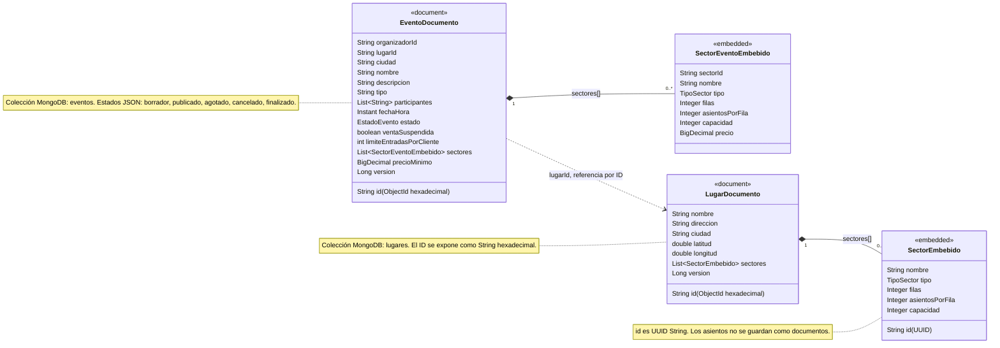

# Gestión de lugares, sectores y eventos

Microservicio Spring Boot de TicketYa. Gestiona lugares físicos, sus sectores y el ciclo de vida de eventos. Persiste en MongoDB en colecciones propias; la comunicación entre servicios usa IDs y llamadas directas.

## Requisitos

- JDK 21 o superior.
- Maven 3.9 o superior.
- Docker Desktop con Docker Compose para MongoDB y las pruebas de integración.
- Node.js (opcional, para simular Reservas o Compras desde Postman).

## Levantar MongoDB y el servicio

Ejecutá estos pasos desde `GestionLugaresFisicos`.

1. Iniciá MongoDB:

   ```sh
   docker compose up -d mongodb
   ```

   MongoDB queda disponible en `localhost:27017`; Compose conserva los datos en `mongodb_data`.

2. Iniciá el servicio:

   ```sh
   mvn spring-boot:run
   ```

   Por defecto, MongoDB usa `mongodb://localhost:27017/ticketya_lugares` y el servicio escucha en `http://localhost:8081`. El perfil predeterminado es `dev` y carga datos de ejemplo.

3. Consultá lugares con headers de identidad:

   ```sh
   curl.exe -H "X-User-Id: organizador-demo" -H "X-User-Role: ORGANIZADOR" http://localhost:8081/lugares
   ```

4. La documentación interactiva está en <http://localhost:8081/swagger-ui/index.html> y el documento OpenAPI en <http://localhost:8081/v3/api-docs>.

Para detener MongoDB sin borrar sus datos:

```sh
docker compose down
```

## Endpoints

El servicio local usa `http://localhost:8081` por defecto. Las rutas públicas requieren `X-User-Id` junto con el rol indicado; los endpoints internos de callback y consulta entre servicios no exigen headers de usuario. El Gateway debe enviar `X-User-Role: CLIENTE`, `ORGANIZADOR` o `ADMIN`. El servicio compara sin distinguir mayúsculas y recorta espacios externos.

| Método | Ruta | Rol requerido | Descripción |
|---|---|---|---|
| POST | `/lugares` | `ADMIN` | Registra un lugar. |
| GET | `/lugares` | `ORGANIZADOR` o `ADMIN` | Lista lugares. |
| GET | `/lugares/{id}` | `ORGANIZADOR` o `ADMIN` | Consulta un lugar y sus sectores. |
| GET | `/lugares/{id}/sectores` | `ORGANIZADOR` o `ADMIN` | Lista los sectores de un lugar. |
| POST | `/lugares/{id}/sectores` | `ADMIN` | Agrega un sector numerado o no numerado. |
| POST | `/eventos` | `ORGANIZADOR` | Crea un evento en borrador. |
| GET | `/eventos` | `CLIENTE`, `ORGANIZADOR` o `ADMIN` | Busca eventos publicados y agotados con `tipo`, `organizadorId`, `participante`, `ciudad`, `fechaDesde`, `fechaHasta`, `orden`, `direccion`, `q`, `page` y `size`. |
| GET | `/eventos/{eventoId}` | `CLIENTE`, `ORGANIZADOR` o `ADMIN` | Devuelve el detalle público; solo el organizador dueño o ADMIN ve un borrador. |
| PUT | `/eventos/{eventoId}/sectores/{sectorId}/precio` | Organizador dueño | Define el precio de un sector del evento en borrador. |
| PUT | `/eventos/{eventoId}/limite-entradas-por-cliente` | Organizador dueño | Actualiza el límite por cliente durante el borrador. |
| PUT | `/eventos/{eventoId}/publicar` | Organizador dueño | Inicializa la disponibilidad con Reservas y publica el evento. |
| PUT | `/eventos/{eventoId}/venta/suspender` | `ADMIN` | Suspende la venta sin crear un estado formal nuevo. |
| PUT | `/eventos/{eventoId}/venta/reactivar` | `ADMIN` | Reactiva la venta. |
| PUT | `/eventos/{eventoId}/cancelar` | `ADMIN` | Cancela el evento después de confirmarlo con Reservas; body opcional `{"motivo":"..."}`. |
| PUT | `/eventos/{eventoId}/disponibilidad` | Interno: Reservas | Recibe el aviso de agotado o recuperación. No exige `X-User-Id` ni `X-User-Role`; no debe exponerse por el API Gateway. |
| GET | `/internal/eventos/{eventoId}` | Interno: Compras | Consulta datos del evento en cualquier estado. No exige headers de usuario y no debe exponerse por el API Gateway. |

Las rutas de gestión de eventos y lugares devuelven errores controlados con `timestamp`, `status`, `error` y `mensaje`; `campos` se incluye como lista de `{campo, mensaje}` cuando corresponde.

## Integración con otros servicios

La comunicación entre servicios en la Entrega 1 es directa, por REST/JSON, y no usa autenticación entre servicios. El Gateway propaga los headers de usuario solo para las rutas públicas.

El documento [docs/api-gateway-contract.md](docs/api-gateway-contract.md) detalla los paths, headers y reglas de reenvío para el API Gateway.

### Reservas — contrato confirmado

URL base: propiedad `reservas.base-url`, predeterminada en `http://localhost:8080`. Timeouts: `reservas.connect-timeout` (2 s) y `reservas.read-timeout` (5 s).

Este servicio hace estas llamadas a Reservas:

1. **Inicializar disponibilidad al publicar:** `PUT /disponibilidad/eventos/{eventoId}`. Envía `limiteEntradasPorCliente` y los sectores; para sectores numerados deriva los pares `{fila, numero}` y su `capacidadTotal` a partir de filas × asientosPorFila. La respuesta esperada es `204`; repetir la inicialización con los mismos datos es idempotente.
2. **Cambiar el estado de venta:** `PUT /disponibilidad/eventos/{eventoId}/venta`, con `{"estado":"ACTIVA"}`, `SUSPENDIDA`, `CANCELADA` o `FINALIZADA`. La respuesta esperada es `204`.
3. **Consultar disponibilidad en el detalle:** al consultar un evento `publicado` o `agotado`, este servicio llama `GET /disponibilidad/eventos/{eventoId}` y combina la respuesta por `sectorId`. Si Reservas no responde o devuelve error, el detalle se devuelve igual y `disponibilidad` queda en `null`. Para otros estados no se consulta a Reservas.

Reservas llama a este servicio mediante el callback `PUT /eventos/{eventoId}/disponibilidad`, con `{"agotado":true}` o `{"agotado":false}`. Responde `204` para cambios, avisos duplicados y avisos tardíos de eventos cancelados o finalizados; `404` si el evento no existe y `409` si sigue en borrador. El callback es interno, sin headers de usuario y fuera del Gateway.

Si Reservas falla, no responde o no confirma con `204`, publicar responde `503` y el evento queda en borrador. Si falla al suspender, reactivar o cancelar, el servicio responde `503` y no cambia el estado local; la operación se puede reintentar.

### Compras — contrato confirmado

Contrato confirmado con Compras y Devoluciones. URL base configurable con `compras.base-url` (default `http://localhost:8083`); timeouts: `compras.connect-timeout` (2 s) y `compras.read-timeout` (5 s).

- **Consulta interna de evento:** Compras llama directamente `GET /internal/eventos/{eventoId}` sin headers de usuario. Devuelve eventoId, nombre, `fechaInicio` en ISO-8601 UTC, estado en minúsculas y sectores con precio decimal o `null` si todavía no se definió. Responde `200` o `404`.
- **Aviso de cancelación:** este servicio llama `POST /eventos-cancelados` después de que Reservas confirmó la cancelación y el evento local quedó cancelado. `202` y `200` se consideran éxito. Si Compras no responde o devuelve error, la cancelación permanece hecha y el administrador recibe `200`; el aviso queda guardado y se reenvía automáticamente cada `eventos.cancelacion.reenvio-interval` (default `60s`).

El GET interno es una ruta directa entre servicios: no exige `X-User-Id` ni `X-User-Role` y no se publica por el Gateway. Los errores remotos del aviso no revierten la cancelación.

## Puertos

Este servicio usa el puerto `8081` por defecto (`PORT` permite sobrescribirlo). Reservas usa `8080` en el entorno local; mantené ambos puertos separados.

## Variables de entorno y comandos

`application.yml` y las clases de propiedades de los clientes definen estos nombres y defaults:

| Variable de entorno | Propiedad | Default |
|---|---|---|
| `PORT` | `server.port` | `8081` |
| `MONGODB_URI` | `spring.data.mongodb.uri` | `mongodb://localhost:27017/ticketya_lugares` |
| `RESERVAS_BASE_URL` | `reservas.base-url` | `http://localhost:8080` |
| `RESERVAS_CONNECT_TIMEOUT` | `reservas.connect-timeout` | `2s` |
| `RESERVAS_READ_TIMEOUT` | `reservas.read-timeout` | `5s` |
| `COMPRAS_BASE_URL` | `compras.base-url` | `http://localhost:8083` |
| `COMPRAS_CONNECT_TIMEOUT` | `compras.connect-timeout` | `2s` |
| `COMPRAS_READ_TIMEOUT` | `compras.read-timeout` | `5s` |
| `EVENTOS_FINALIZACION_INTERVAL` | `eventos.finalizacion.interval` | `60s` |
| `EVENTOS_CANCELACION_REENVIO_INTERVAL` | `eventos.cancelacion.reenvio-interval` | `60s` |
| `SPRING_PROFILES_ACTIVE` | Perfil activo de Spring | `dev` (perfil predeterminado) |

Ejemplos para configurar variables e iniciar el servicio desde la carpeta `GestionLugaresFisicos`:

**PowerShell**

```powershell
$env:PORT = "8081"
$env:MONGODB_URI = "mongodb://localhost:27017/ticketya_lugares"
$env:RESERVAS_BASE_URL = "http://localhost:8080"
$env:RESERVAS_CONNECT_TIMEOUT = "2s"
$env:RESERVAS_READ_TIMEOUT = "5s"
$env:COMPRAS_BASE_URL = "http://localhost:8083"
$env:COMPRAS_CONNECT_TIMEOUT = "2s"
$env:COMPRAS_READ_TIMEOUT = "5s"
$env:EVENTOS_FINALIZACION_INTERVAL = "60s"
$env:EVENTOS_CANCELACION_REENVIO_INTERVAL = "60s"
$env:SPRING_PROFILES_ACTIVE = "dev"
mvn spring-boot:run
```

**cmd**

```bat
set PORT=8081
set MONGODB_URI=mongodb://localhost:27017/ticketya_lugares
set RESERVAS_BASE_URL=http://localhost:8080
set RESERVAS_CONNECT_TIMEOUT=2s
set RESERVAS_READ_TIMEOUT=5s
set COMPRAS_BASE_URL=http://localhost:8083
set COMPRAS_CONNECT_TIMEOUT=2s
set COMPRAS_READ_TIMEOUT=5s
set EVENTOS_FINALIZACION_INTERVAL=60s
set EVENTOS_CANCELACION_REENVIO_INTERVAL=60s
set SPRING_PROFILES_ACTIVE=dev
mvn spring-boot:run
```

**Git Bash**

```bash
export PORT=8081
export MONGODB_URI=mongodb://localhost:27017/ticketya_lugares
export RESERVAS_BASE_URL=http://localhost:8080
export RESERVAS_CONNECT_TIMEOUT=2s
export RESERVAS_READ_TIMEOUT=5s
export COMPRAS_BASE_URL=http://localhost:8083
export COMPRAS_CONNECT_TIMEOUT=2s
export COMPRAS_READ_TIMEOUT=5s
export EVENTOS_FINALIZACION_INTERVAL=60s
export EVENTOS_CANCELACION_REENVIO_INTERVAL=60s
export SPRING_PROFILES_ACTIVE=dev
mvn spring-boot:run
```

## Pruebas con Postman

En `postman/` están las dos colecciones:

- `TicketYa-Lugares.postman_collection.json`: pruebas de lugares y sectores.
- `TicketYa-Eventos.postman_collection.json`: pruebas de eventos e integración con Reservas.

Para el flujo de eventos, ejecutá primero **00 Preparación**. La carpeta **05 Publicar y gestión: validaciones previas** funciona con Reservas encendido o apagado. La carpeta **08 GET interno para Compras** se puede ejecutar después de la preparación y no depende de los servicios externos.

Las carpetas de aviso de cancelación se ejecutan en este orden y con estos servicios:

1. **09 [Reservas y Compras ENCENDIDOS]** requiere ambos servicios respondiendo en `localhost:8080` y `localhost:8083`.
2. **10 [Reservas ENCENDIDO, Compras APAGADO]** requiere Reservas respondiendo en `localhost:8080` y que Compras no esté disponible en `localhost:8083`.
3. **11 [Correr después de la 10]** se ejecuta después de volver a encender Compras en `localhost:8083` y esperar el siguiente ciclo de reenvío, hasta `eventos.cancelacion.reenvio-interval` (60 s por defecto).

Las carpetas **09 y 10 son excluyentes**: usan escenarios de cancelación separados. La 11 completa el caso de aviso pendiente creado en la 10.

Para simular Compras, desde `GestionLugaresFisicos` ejecutá en otra terminal:

```sh
node postman/compras-stub.js
```

El stub escucha en `localhost:8083` por defecto (`PORT` permite cambiarlo), imprime y registra los avisos recibidos. Devuelve `202` al aceptar uno nuevo y `200` cuando ya lo procesó. Permite consultar los avisos con `GET /_stub/avisos`. Requiere Node.js.

Para los escenarios anteriores que prueban publicación y fallas de Reservas, ejecutá **06** o **07** por separado:

- **06 [Reservas ENCENDIDO]** necesita Reservas respondiendo en `localhost:8080`.
- **07 [Reservas APAGADO]** requiere que no haya ningún proceso escuchando en el puerto `8080`.

Las carpetas **06 y 07 también son excluyentes**.

Para simular Reservas en local, desde la carpeta `GestionLugaresFisicos` ejecutá en otra terminal:

```sh
node postman/reservas-stub.js
```

El stub de Reservas escucha en el puerto `8080` por defecto (`PORT` permite cambiarlo), imprime los pedidos recibidos y valida el formato de las rutas y los cuerpos de Reservas. Requiere Node.js.

## Ejecutar las pruebas automatizadas

Desde `GestionLugaresFisicos`:

```sh
mvn test
```

Las pruebas de integración de MongoDB usan Testcontainers y requieren Docker iniciado.

## Modelo de datos

Los lugares están en la colección `lugares`, con sectores embebidos. Los asientos no se persisten: en sectores numerados se derivan de `filas` × `asientosPorFila` y se identifican como `(sectorId, fila, numero)`.

Los eventos están en la colección `eventos`. Copian la ciudad y la configuración/nombre de los sectores del lugar; precios y `precioMinimo` usan `BigDecimal`/Decimal128. En la respuesta JSON, los estados se serializan en minúsculas: `borrador`, `publicado`, `agotado`, `cancelado` y `finalizado`. `ventaSuspendida` es un indicador independiente. El límite de entradas por cliente es entero y vale `4` por defecto. `fechaHora` es la fecha y hora de inicio; al pasarla, el proceso automático finaliza el evento.


