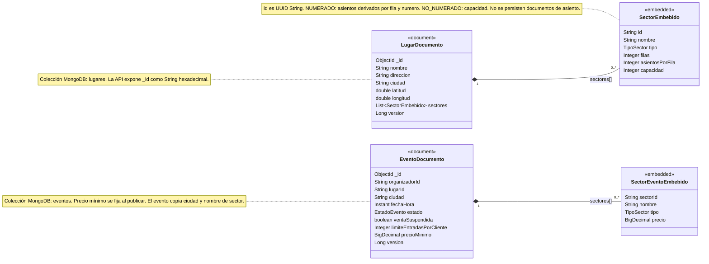

# Gestión de lugares, sectores y eventos

Microservicio Spring Boot de TicketYa. Persiste lugares y sus sectores embebidos en MongoDB.

## Requisitos

- JDK 21 o superior.
- Maven 3.9 o superior.
- Docker Desktop con Docker Compose disponible.

## Levantar MongoDB y el servicio

Ejecutá estos pasos desde la carpeta `GestionLugaresFisicos`.

1. Iniciá MongoDB en segundo plano:

   ```powershell
   docker compose up -d mongodb
   ```

   MongoDB queda disponible en `localhost:27017`. Compose conserva los datos en el volumen `mongodb_data`.

2. Iniciá el microservicio:

   ```powershell
   mvn spring-boot:run
   ```

   La URI predeterminada es `mongodb://localhost:27017/ticketya_lugares` y el puerto HTTP predeterminado es `8081`. Se pueden cambiar con `MONGODB_URI` y `PORT`.

   Sin un perfil activo, la aplicación usa `dev` y carga idempotentemente dos lugares de ejemplo. Cada lugar contiene un sector numerado y uno no numerado. Si ya existen los IDs de ejemplo, no los vuelve a insertar.

3. Consultá los lugares con un rol permitido:

   ```powershell
   curl.exe -H "X-User-Id: organizador-demo" -H "X-User-Role: organizador" http://localhost:8081/lugares
   ```

   Los GET requieren `X-User-Id` y `X-User-Role`; se permiten los roles `organizador` y `administrador`. Los POST de gestión requieren el rol `administrador`.

4. Abrí la documentación interactiva de la API en <http://localhost:8081/swagger-ui/index.html>. El documento OpenAPI está en <http://localhost:8081/v3/api-docs>.

El contrato de paths, headers y reenvío para el API Gateway está en [docs/api-gateway-contract.md](docs/api-gateway-contract.md).

Para detener el servicio, interrumpí `mvn spring-boot:run` con `Ctrl+C`. Luego podés detener MongoDB sin borrar sus datos:

```powershell
docker compose down
```

## Ejecutar las pruebas

Desde `GestionLugaresFisicos`, ejecutá:

```powershell
mvn test
```

La prueba de integración de MongoDB usa Testcontainers y requiere que Docker esté iniciado.

## Perfil de producción

Los datos de ejemplo solo se cargan con el perfil `dev`. En PowerShell, para un despliegue activá un perfil distinto, por ejemplo:

```powershell
$env:SPRING_PROFILES_ACTIVE = "prod"
$env:MONGODB_URI = "mongodb://servidor:27017/ticketya_lugares"
mvn spring-boot:run
```

## Modelo de datos

Cada documento de la colección `lugares` contiene los datos del lugar y un arreglo `sectores`. El ID del lugar se almacena como ObjectId; el ID de cada sector embebido es un UUID String. No hay una colección de asientos: para sectores numerados, cada asiento se identifica por `(sectorId, fila, numero)` y se deriva de `filas` y `asientosPorFila`.

La colección `eventos` guarda eventos con sus sectores y precios embebidos. Copia la ciudad del lugar y el nombre/configuración de cada sector al crear; el precio y `precioMinimo` usan BigDecimal/Decimal128. Los estados posibles son `borrador`, `publicado`, `agotado`, `cancelado` y `finalizado`; `ventaSuspendida` es un indicador separado. El límite de entradas por cliente vale 4 por defecto. La fecha/hora de inicio se almacena en UTC y un evento se considera finalizado al pasarla.

Los endpoints locales implementados para eventos son `POST /eventos`, `PUT /eventos/{eventoId}/sectores/{sectorId}/precio` y `PUT /eventos/{eventoId}/limite-entradas-por-cliente`. Para alta se requieren `X-User-Id` y `X-User-Role: organizador`; las modificaciones de precio y límite solo las puede hacer el organizador dueño mientras el evento está en borrador.

Los errores controlados responden `timestamp`, `status`, `error`, `mensaje` y, para validación de campos, `campos` como lista de `{campo, mensaje}`. La propiedad `campos` se omite si no aplica.


