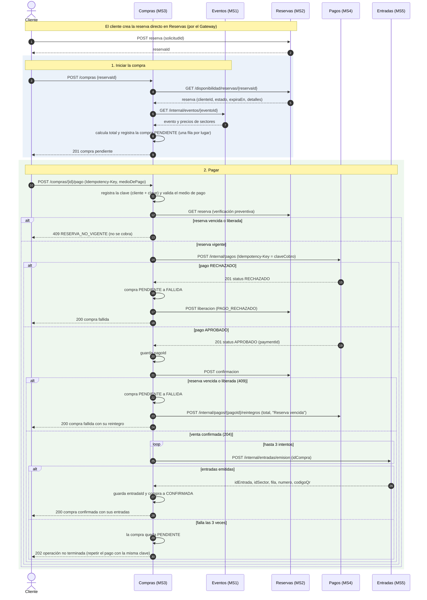
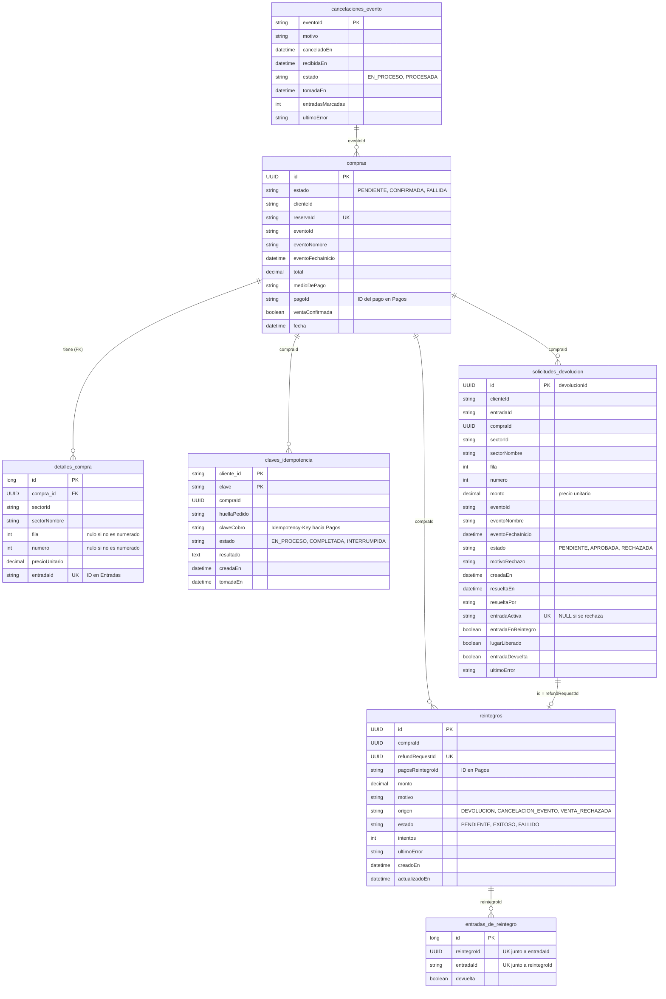

# TicketYa — Microservicio 3 (Compras y Devoluciones): diagramas

Diagramas de la Entrega 1, generados a partir de las entidades y los servicios del código en `compras/`. Los archivos fuente (`.mmd`) y las imágenes (`.png`) están en esta carpeta; GitHub y VS Code (con una extensión de Mermaid) muestran los bloques de abajo directamente.

## 1. Diagrama de secuencia de la compra

Cubre el camino feliz y sus ramas: reserva no vigente, pago rechazado, venta rechazada después del cobro (con reintegro automático) y emisión de entradas fallida (la compra queda pendiente y el pago responde 202).

Fuente Mermaid

## 2. Diagrama entidad-relación

Notas de lectura:

- La única clave foránea real es `detalles_compra.compra_id` hacia `compras.id`. Las demás relaciones son referencias lógicas por identificador (`compraId`, `reintegroId`, `eventoId`): este servicio no tiene claves foráneas hacia datos de otros servicios y tampoco las usa entre sus propias tablas de coordinación.
- `claves_idempotencia` tiene clave primaria compuesta (`cliente_id`, `clave`): la clave solo vale para el cliente que la envió.
- `solicitudes_devolucion.id` es el `devolucionId` y se usa como `refundRequestId` del reintegro de esa devolución.
- `solicitudes_devolucion.entradaActiva` tiene restricción única: es la copia del `entradaId` mientras la solicitud está pendiente o aprobada, y queda `NULL` al rechazarse. Así una entrada tiene a lo sumo una solicitud activa.
- `reintegros.origen` distingue una devolución, una cancelación de evento y una venta rechazada después del cobro. En una cancelación, `entradas_de_reintegro` guarda qué entradas cubre cada reintegro y si ya pasaron a devueltas.
- `fila` y `numero` son enteros y quedan nulos en los sectores no numerados.

Fuente Mermaid

