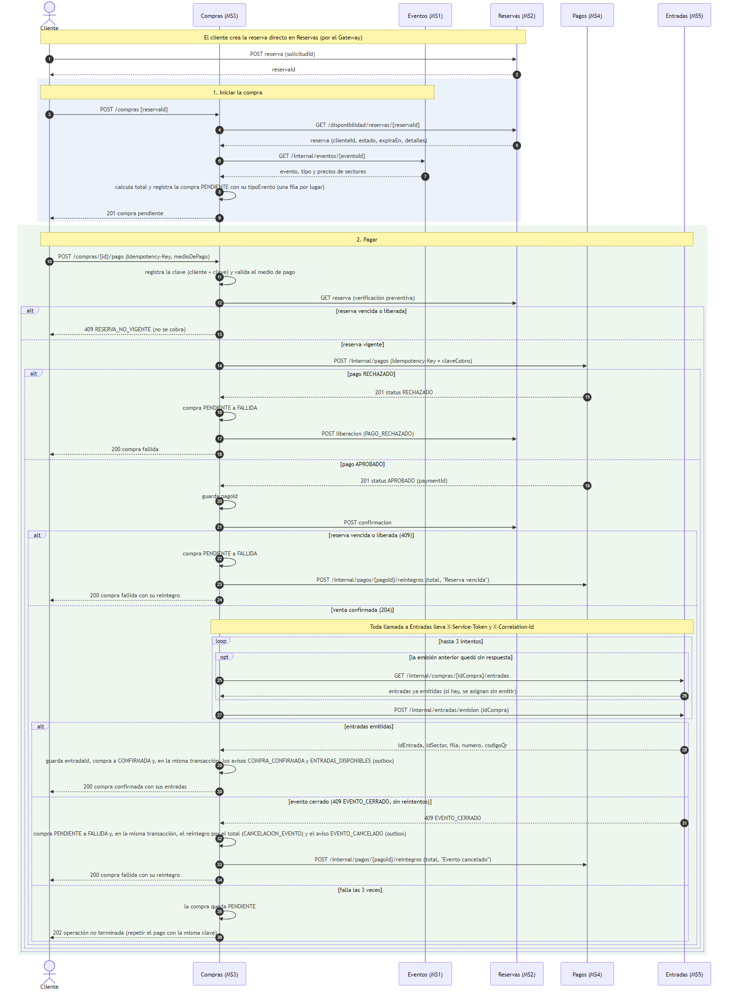
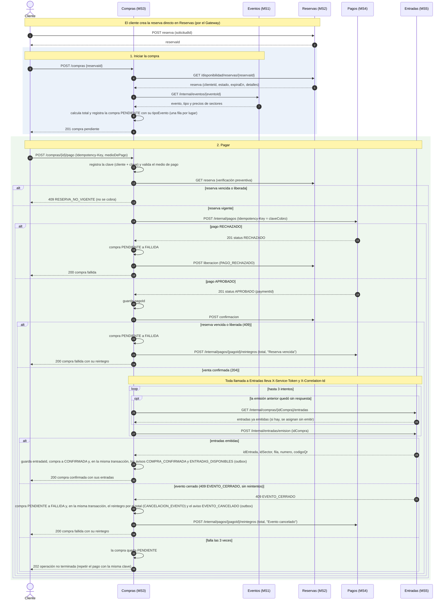
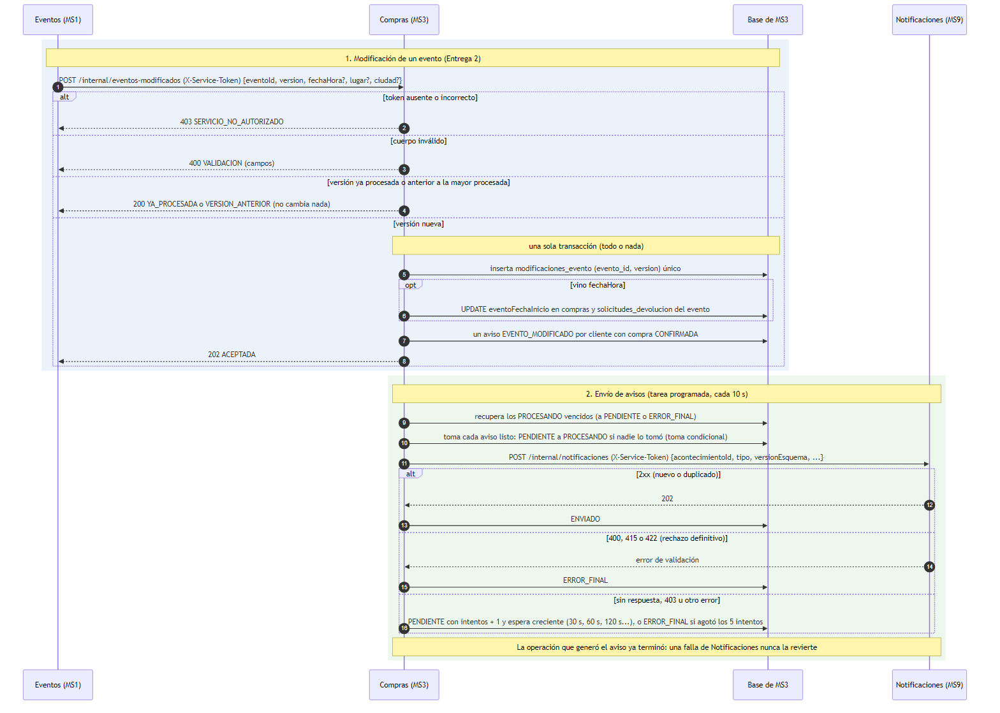
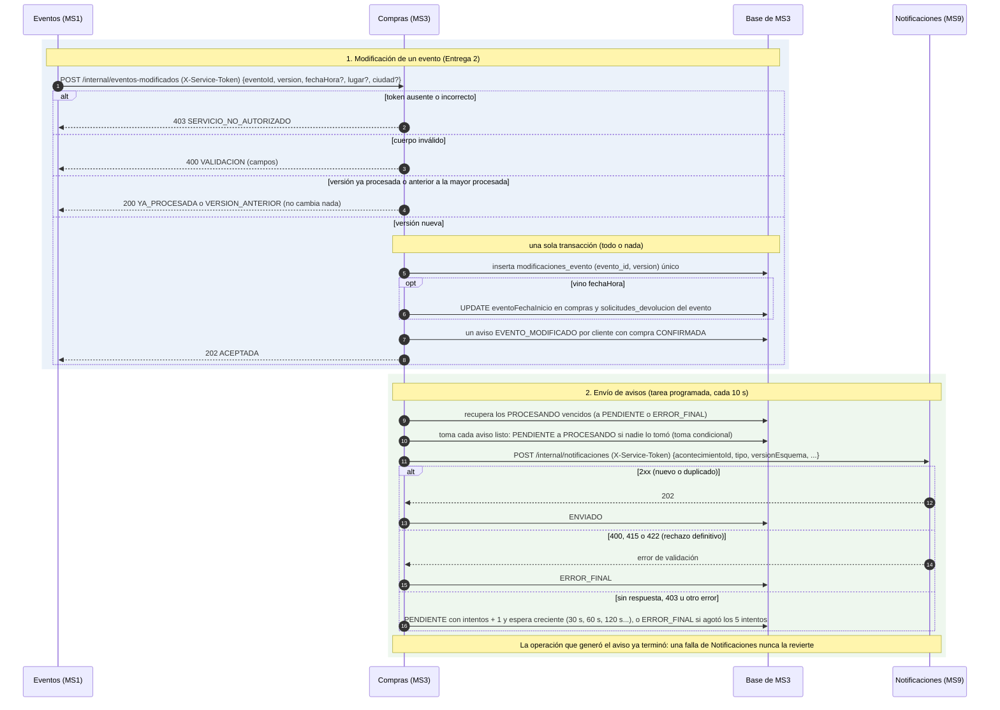
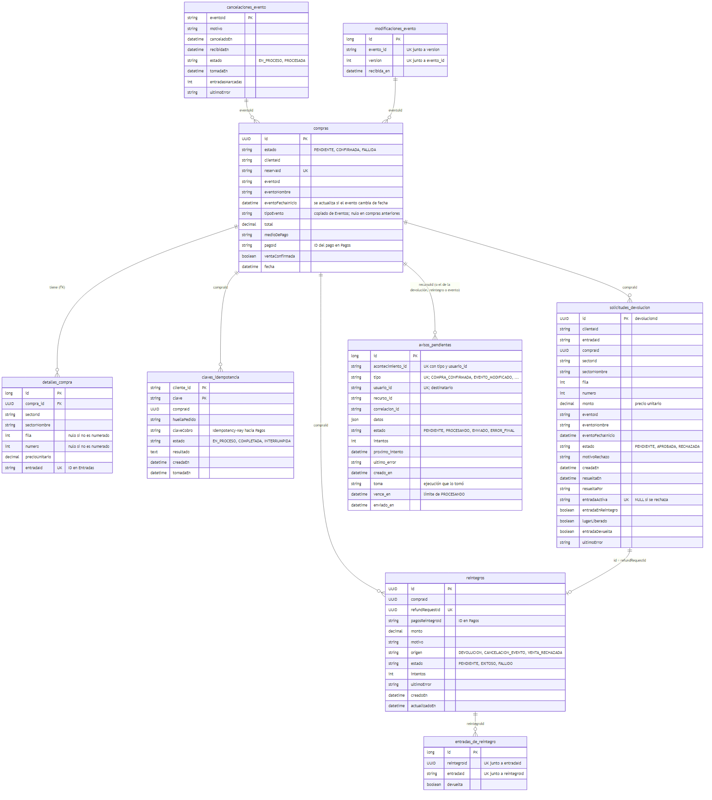
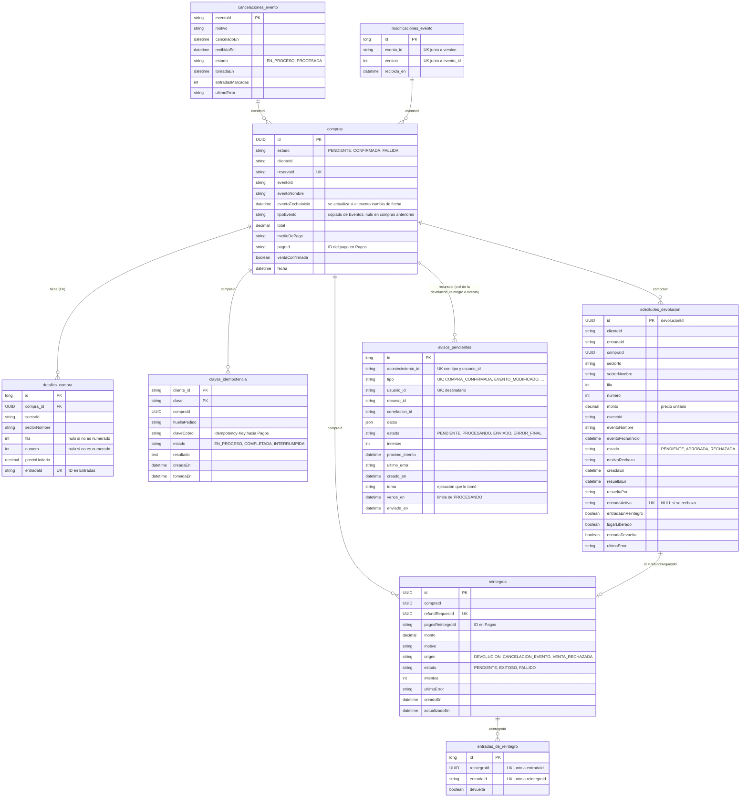

# TicketYa — Microservicio 3 (Compras y Devoluciones): diagramas

Diagramas de las Entregas 1 y 2, generados a partir de las entidades y los servicios del código en `Backend/mcsv-compras-devoluciones/`. Los archivos fuente (`.mmd`) y las imágenes (`.png`) están en esta carpeta; GitHub y VS Code (con una extensión de Mermaid) muestran los bloques de abajo directamente.

## 1. Diagrama de secuencia de la compra

Cubre el camino feliz y sus ramas: reserva no vigente, pago rechazado, venta rechazada después del cobro (con reintegro automático), evento cerrado al emitir (Entrega 2: compra fallida con reintegro automático y aviso de evento cancelado) y emisión de entradas fallida (la compra queda pendiente y el pago responde 202). Antes de repetir una emisión sin respuesta, se consultan las entradas de la compra.

Fuente Mermaid

## 2. Diagrama de secuencia de la modificación de un evento y del envío de avisos (Entrega 2)

Eventos avisa el cambio de fecha, horario o lugar; este servicio lo aplica en una sola transacción, idempotente por evento y versión, y deja un aviso por comprador en el outbox. La tarea de envío reparte después esos avisos (y los de compras, devoluciones, reintegros y cancelaciones) a Notificaciones, con reintentos.

Fuente Mermaid

## 3. Diagrama entidad-relación

Notas de lectura:

- La única clave foránea real es `detalles_compra.compra_id` hacia `compras.id`. Las demás relaciones son referencias lógicas por identificador (`compraId`, `reintegroId`, `eventoId`): este servicio no tiene claves foráneas hacia datos de otros servicios y tampoco las usa entre sus propias tablas de coordinación.
- `claves_idempotencia` tiene clave primaria compuesta (`cliente_id`, `clave`): la clave solo vale para el cliente que la envió.
- `solicitudes_devolucion.id` es el `devolucionId` y se usa como `refundRequestId` del reintegro de esa devolución.
- `solicitudes_devolucion.entradaActiva` tiene restricción única: es la copia del `entradaId` mientras la solicitud está pendiente o aprobada, y queda `NULL` al rechazarse. Así una entrada tiene a lo sumo una solicitud activa.
- `reintegros.origen` distingue una devolución, una cancelación de evento y una venta rechazada después del cobro. En una cancelación, `entradas_de_reintegro` guarda qué entradas cubre cada reintegro y si ya pasaron a devueltas.
- `fila` y `numero` son enteros y quedan nulos en los sectores no numerados.
- `compras.tipoEvento` (Entrega 2) se copia de Eventos al iniciar la compra; las compras anteriores quedan con el tipo nulo y no cuentan en el historial de preferencias.
- `modificaciones_evento` tiene restricción única (`evento_id`, `version`): la misma modificación se aplica una sola vez.
- `avisos_pendientes` es el outbox hacia Notificaciones. Su restricción única (`acontecimiento_id`, `tipo`, `usuario_id`) es la misma clave con la que Notificaciones deduplica: los avisos de un evento a cada comprador comparten `acontecimiento_id`. `recurso_id` apunta a la compra, la devolución, el reintegro o el evento, según el tipo.

Fuente Mermaid

