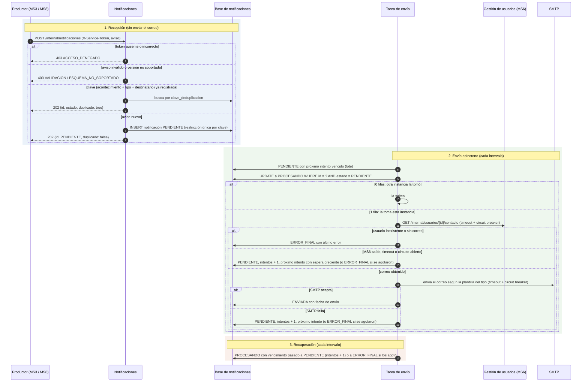
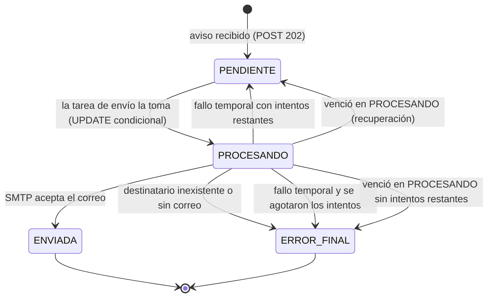
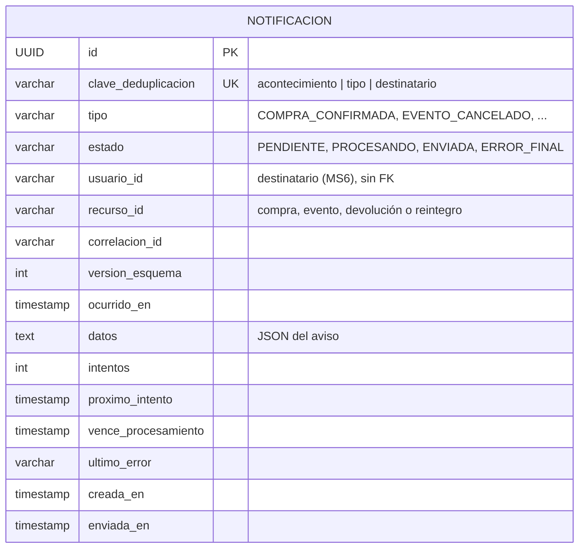

# TicketYa — Gestión de notificaciones: diagramas

Diagramas del servicio de la Entrega 2, generados a partir del código en [`Backend/mcsv-notificaciones/`](../Backend/mcsv-notificaciones). Las fuentes Mermaid (`.mmd`) están en [`diagramas-notificaciones/`](diagramas-notificaciones); GitHub y VS Code (con una extensión de Mermaid) muestran los bloques de abajo directamente.

## 1. Diagrama de secuencia: recepción, envío y recuperación

Cubre la recepción idempotente (403, 400, reentrega y aviso nuevo), la selección atómica con la actualización condicional, el envío con sus fallos temporales y definitivos, y la recuperación de las notificaciones que quedaron en PROCESANDO.

## 2. Diagrama de estados de una notificación

## 3. Modelo de datos

Una sola tabla. El destinatario se guarda solo por ID (el correo se pide a Gestión de usuarios al enviar) y no hay claves foráneas a otros servicios.

